# Контролна точка на проекта: Архитектура, данни и изпълнение (ecommerce-backend)

**Версия на кода**: Commit `958fe89bb89a4c8d1461ac073d699e0e310ea744` (съкратено: `958fe89`)  
**Текущ клон**: `feat/order-paid-notifications`  
**Статус на работното дърво**: Чисто (`working tree clean`, без незаписани или неизчистени промени)  
**Дата на документиране**: Ноември 2026 г.

---

## 1. Какъв продукт сме построили

### 1.1. Основен потребителски сценарий
`ecommerce-backend` представлява надеждна, високопроизводителна бекенд система за електронна търговия, гарантираща абсолютна финансова и складова консистентност (съгласуваност на данните) при паралелни клиентски поръчки и външни картови плащания.

Основният жизнен цикъл на потребителското взаимодействие обхваща:
1. **Регистрация и автентикация**: Клиентът създава профил (`POST /users`), влиза в системата с парола (`POST /auth/login`) и получава кратковременен JWT токен (JSON Web Token — криптографски подписан стандарт за пренос на удостоверителни данни).
2. **Преглед на каталог**: Разглеждане на налични активни артикули (`GET /products`) с пагинация (странициране).
3. **Управление на количка**: Добавяне и промяна на количества (`PUT /cart/items/{id}`) и преглед на междинната калкулация (`GET /cart`). Цените се изчисляват динамично спрямо актуалния каталог, без да се блокира складова наличност.
4. **Оформяне на поръчка (Checkout)**: Идемпотентно (операция, чието многократно повторение със същите входни данни не променя крайния резултат) превръщане на количката в поръчка (`POST /orders` с `Idempotency-Key` UUID хедър). В атомарна (неделима) транзакция се заключват редовете на артикулите в каталога, проверява се наличността, резервира се складът, записват се позициите със запазени исторически цени и се изчиства потребителската количка.
5. **Плащане през Stripe Checkout**: Клиентът генерира платежна сесия (`POST /orders/{id}/checkout-session`), пренасочва се към външната платежна страница на Stripe (с поддръжка както на банкови карти, така и на отложени методи като SEPA Direct Debit), след което Stripe връща резултата към бекенда чрез криптографски подписан webhook.
6. **Надеждни известия (Transactional Outbox)**: При преминаване на поръчка в статус `paid` в същата транзакция се записва събитие в outbox таблица. Фоновият процес (`scripts/process_outbox.py`) прочита събитието, изпраща форматиран имейл през SMTP (локално чрез Mailpit) и маркира събитието като доставено без риск от загуба на писмо или дублирано намаляване на склад при срив на мрежата.

### 1.2. Какво работи сега
- **Потребители и роли**: Регистрация с Argon2id хеширане, вход с издаване на HS256 JWT токен (15 мин.), валидация на текущия потребител срещу базата при всяка заявка (`CurrentUserDep`), защита от timing attacks чрез dummy hash при липсващ потребител, CLI команда за контролирано повишаване в администратор (`scripts/promote_admin.py`).
- **Каталог**: Листване с пагинация (`limit`, `offset`), скриване на неактивни продукти за клиенти (404 Not Found), CRUD операции за администратори (`POST /products`, `PATCH /products/{id}`), Check constraints за неотрицателна цена/наличност и валута `EUR`.
- **Количка**: Изолация по потребител (никога не се подава `user_id` от клиента), атомарен PostgreSQL upsert (`INSERT ... ON CONFLICT DO UPDATE`), динамично ценообразуване, групова заявка с `IN` клауза (без N+1 проблем), запазване на деактивирани продукти с флаг `available: false`.
- **Поръчки**: Атомарно оформяне със заключване `FOR UPDATE ORDER BY id ASC` за елиминиране на deadlocks (мъртва хватка между паралелни транзакции), намаляване на наличност, исторически слепок на цени и заглавия в `order_items`, идемпотентност на ниво потребител + UUID ключ (`uq_orders_user_id_idempotency_key`), ръчен отказ (`POST /orders/{id}/cancel`) с безопасно връщане на наличност.
- **Stripe Checkout**: Инициализация на сесии, съхраняване на записи в `stripe_checkout_sessions`, верификация на подписи на webhook (`stripe.Webhook.construct_event`), идемпотентно регистриране на събития в `stripe_processed_events`, обработка на `checkout.session.completed`, `checkout.session.async_payment_succeeded`, `checkout.session.async_payment_failed`, `checkout.session.expired`.
- **Transactional Outbox & Имейли**: Запис на `order.paid` събития в `order_outbox_events` в транзакцията на плащането; фонов worker `scripts/process_outbox.py` с отделни кратки транзакции за извличане и отбелязване на статус `sent` / `failed`; интеграция с Mailpit по SMTP (порт 1025) и валидация през REST API (порт 8025); автоматизиран retry цикъл при недостъпен SMTP сървър (`make test-notifications-retry`).

### 1.3. Среда за изпълнение: Тестова среда срещу Live конфигурация
- **Stripe интеграция**: Модулът поддържа поле `mode` (`test` или `live`). В тестова среда използваме тестови ключове (`STRIPE_SECRET_KEY=sk_test_...`, `STRIPE_WEBHOOK_SECRET=whsec_...`). Системата валидира дали сесията съответства на зададения режим и предотвратява обработка на събития от друга среда. В реална live среда е необходима единствено замяна на променливите в `.env` с реални ключове от Stripe Dashboard и насочване на публичен HTTPS webhook URL.
- **Имейл доставка (SMTP)**: В локална среда и CI се използва контейнер с **Mailpit** (локален сървър за улавяне на писма, който не изпраща реална поща към интернет). За преминаване към live среда кодът използва стандартния Python `smtplib.SMTP` клиент, управляван от променливи на средата (`SMTP_HOST`, `SMTP_PORT`, `SMTP_USER`, `SMTP_PASSWORD`, `SMTP_FROM_EMAIL`, `SMTP_USE_TLS`). Смяната към SendGrid, AWS SES или Mailgun става чрез настройка на съответните SMTP credentials без промяна в кода.
- **База данни**: Контейнеризиран PostgreSQL 17 с отделен персистентен volume за разработка (`commerce_postgres_data`) и динамично създавана изолирана база `commerce_test` за тестовете.

### 1.4. Какво още не е реализирано или проверено
- **Не е реализиран HTTP `/health` краен път**: В приложението липсва dedicated `/health` или `/healthz` рутер. Здравните проверки (healthchecks) в `compose.yaml` проверяват готовността на PostgreSQL чрез `pg_isready` и на Mailpit чрез HTTP порт 8025, но не и на самото FastAPI приложение.
- **Липсва фонов планировчик (cron/daemon) за Outbox worker-а**: `scripts/process_outbox.py` е CLI команда за пакетна обработка (batch script), която се извиква еднократно или от периодичен шедулър. В текущия репозиторий няма конфигуриран системен демон (systemd unit, Celery beat или k8s CronJob), който да го изпълнява на всеки 10 секунди в продукция.
- **Няма UI фронтенд клиент**: Клиентското взаимодействие се осъществява през Swagger UI (`/docs`), OpenAPI схема или curl/HTTP заявки.
- **Таблица `payment_attempts`**: Запазена е в базата и ORM моделите от по-ранен симулационен етап преди Stripe Checkout. Тя не се използва в текущия Stripe поток, но съществува в миграциите.
- **Доставка на писма тип "At-least-once"**: При срив на Outbox worker процеса между успешното предаване на писмото към SMTP сървъра и финалния запис в базата, събитието може да се изпрати повторно при следващия пуск (няма 100% защита от дублиран имейл на ниво SMTP, тъй като протоколът SMTP не е транзакционен спрямо външна база данни).

### 1.5. Дефиниция на архитектурата: Модулен монолит, отделен процес и микросервиси
- **Реалната организация на проекта е Модулен монолит (Modular Monolith)**:
  - Целият приложен код се намира в една услуга `services/commerce/app/` и се компилира/стартира като един FastAPI процес.
  - Вътрешната архитектура е строго разделена по функционални домейни (`accounts`, `catalog`, `cart`, `orders`, `payments`), които споделят обща инфраструктура (база данни, конфигурация, Alembic миграции), но поддържат отделни рутери, схеми, услуги и репозиторита.
- **Отделен процес за фонова обработка (Worker)**:
  - `scripts/process_outbox.py` е самостоятелен процес, споделящ ORM моделите и базата данни, изпълняващ асинхронния Transactional Outbox pattern. Той е отделен от HTTP цикъла на заявките, за да предпази API сървъра от блокиране по време на бавни мрежови SMTP операции.
- **Не е микросервиз**:
  - Каталогът, поръчките, количката и плащанията не са независимо внедрими услуги, не комуникират по HTTP/gRPC помежду си и споделят обща транзакционна PostgreSQL база. Опитът да се нарече тази система "микросервизи" би бил архитектурно неверен. Това е образцов модулен монолит с асинхронен worker.

---

## 2. Карта на кода и организация на компонентите

### 2.1. Йерархия на файловата система
```text
ecommerce-backend/
├── compose.yaml                      # Декларация на Docker услуги: db (Postgres 17), mailpit, api
├── Makefile                          # Помощни команди (напр. make test-notifications-retry)
├── pyproject.toml                    # Метаданни на проекта в корена
├── README.md                         # Основно ръководство за стартиране и употреба
├── docs/                             # Проектна документация
│   ├── project-checkpoint.md         # Настоящият подробен архитектурен документ
│   └── session-state.md              # Кратък статус на последната сесия (до 20 реда)
└── services/
    └── commerce/                     # Основно приложение Commerce
        ├── Dockerfile                # Инструкции за контейнеризация на FastAPI приложението
        ├── pyproject.toml            # Зависимости на Commerce (FastAPI, SQLAlchemy, uv, pytest)
        ├── uv.lock                   # Точно заключени версии на пакетите
        ├── alembic.ini               # Конфигурация на Alembic миграциите
        ├── scripts/                  # CLI помощни и фонови скриптове
        │   ├── seed_products.py      # Идемпотентно зареждане на 100 примерни продукта
        │   ├── promote_admin.py      # Повишаване на клиент до администратор
        │   └── process_outbox.py     # Transactional Outbox worker за изпращане на имейли
        ├── alembic/                  # Миграционни скриптове
        │   ├── env.py                # Alembic среда, конфигурираща Target Metadata от app.db
        │   └── versions/             # 10 версионни миграционни файла (.py)
        ├── tests/                    # Пълен набор автоматизирани тестове (225 теста)
        │   ├── accounts/             # Тестове за регистрация, JWT, пароли и профили
        │   ├── catalog/              # Тестове за продукти, пагинация, права и валидации
        │   ├── cart/                 # Тестове за количка, upsert, изолация и паралелизъм
        │   ├── orders/               # Тестове за поръчки, checkout, отказ и outbox имейли
        │   ├── payments/             # Тестове за Stripe Checkout, webhooks и идемпотентност
        │   ├── infrastructure/       # Тестове за DB връзки, сесии и Alembic миграции
        │   └── contracts/            # Тестове за съответствие на OpenAPI схемата
        └── app/                      # Приложен код на модулния монолит
            ├── main.py               # FastAPI входна точка, lifespan, обработка на грешки
            ├── config.py             # Настройки от околната среда чрез Pydantic Settings
            ├── db.py                 # SQLAlchemy Database клас, Engine, sessionmaker, Base
            ├── dependencies.py       # FastAPI Dependency Injection функции (DbSession, и т.н.)
            └── modules/              # Бизнес модули по домейни
                ├── accounts/         # Модул Потребители и автентикация
                │   ├── models.py     # ORM модел User (users)
                │   ├── schemas.py    # Pydantic схеми (UserCreate, TokenResponse, UserResponse)
                │   ├── router.py     # HTTP рутери: /users, /auth/login, /users/me
                │   ├── service.py    # Бизнес логика: хеширане, проверка на JWT, timing защита
                │   └── repository.py # SQL заявки към таблица users
                ├── catalog/          # Модул Каталог
                │   ├── models.py     # ORM модел Product (products)
                │   ├── schemas.py    # Pydantic схеми (ProductCreate, ProductPatch, ProductResponse)
                │   ├── router.py     # HTTP рутери: GET/POST /products, GET/PATCH /products/{id}
                │   ├── service.py    # Бизнес правила за пагинация и наличности
                │   └── repository.py # SQL заявки към таблица products (FOR UPDATE заключвания)
                ├── cart/             # Модул Потребителска количка
                │   ├── models.py     # ORM модел CartItem (cart_items)
                │   ├── schemas.py    # Pydantic схеми (CartItemUpdate, CartResponse)
                │   ├── router.py     # HTTP рутери: GET /cart, PUT/DELETE /cart/items/{id}
                │   ├── service.py    # Динамично изчисление на суми и наличности
                │   └── repository.py # SQL заявки към cart_items (upsert, clear)
                ├── orders/           # Модул Поръчки и Outbox събития
                │   ├── models.py     # ORM модели: Order, OrderItem, OrderOutboxEvent
                │   ├── schemas.py    # Pydantic схеми (OrderDetailResponse, OrderListResponse)
                │   ├── router.py     # HTTP рутери: POST/GET /orders, POST /orders/{id}/cancel
                │   ├── service.py    # Транзакционна логика: оформяне, отказ, outbox събития
                │   ├── repository.py # SQL операции за поръчки, заключвания и outbox
                │   ├── outbox_processor.py # Бизнес логика за обработка на outbox събития
                │   └── email_service.py    # SMTP клиент и форматиране на текстови писма
                └── payments/         # Модул Stripe плащания
                    ├── models.py     # ORM модели: StripeCheckoutSession, StripeProcessedEvent
                    ├── schemas.py    # Pydantic схеми (CheckoutSessionResponse, WebhookResponse)
                    ├── router.py     # HTTP рутери: /orders/{id}/checkout-session, /webhook/stripe
                    ├── service.py    # Stripe SDK комуникация, проверка на подписи, сверка
                    └── repository.py # SQL заявки към платежните сесии и обработените събития
```

### 2.2. Отговорности на модулите и ключови класове
- **`accounts`**:
  - `User`: ORM модел, представящ таблицата `users` (`email`, `hashed_password`, `role`).
  - `AccountService`: Извършва нормализация на имейли, хеширане с Argon2id, верификация на пароли с dummy hash срещу timing attacks, валидация на JWT токени.
  - `UserRepository`: Управлява създаването, търсенето по ID/email и редовото заключване `lock_user_for_cart_update(user_id)`.
- **`catalog`**:
  - `Product`: ORM модел на артикул от таблицата `products` (`price_minor`, `currency`, `stock`, `active`).
  - `CatalogService`: Филтрира неактивни продукти за клиенти, проверява права на администратор при създаване и редакция.
  - `ProductRepository`: Извлича продукти с пагинация и изпълнява заключване `get_products_for_update(product_ids)` със строго сортиране по ID възходящо.
- **`cart`**:
  - `CartItem`: ORM модел на позиция в количката със съставен първичен ключ `(user_id, product_id)` и ограничение на количеството `1..99`.
  - `CartService`: Зарежда продуктите групово с една SQL заявка с `IN` клауза, изчислява динамични междинни суми и флагове `available`.
  - `CartRepository`: Изпълнява атомарен `upsert_item` чрез PostgreSQL клаузата `ON CONFLICT (user_id, product_id) DO UPDATE`.
- **`orders`**:
  - `Order`: ORM модел на поръчката (`BigInteger` ID, `pending_payment`, `paid`, `cancelled` и т.н., уникален ключ по `user_id + idempotency_key`).
  - `OrderItem`: Исторически запис на артикул в поръчка със замразена единична цена и заглавие.
  - `OrderOutboxEvent`: Транзакционно събитие (`order_outbox_events`), записващо събития тип `order.paid` с JSON полезен товар (payload).
  - `OrderService`: Управлява атомарния преход от количка към поръчка, намалява складова наличност, обработва канселиране и възстановяване на склад.
  - `OrderRepository` и `OrderOutboxRepository`: Управляват записите в БД за поръчки и събития за изпращане.
  - `OutboxProcessor`: Извлича чакащи събития (`pending`), диспечира изпращането им и отразява статуса в базата.
  - `SmtpClient`: Директен обвиващ клас над `smtplib.SMTP` за надеждна доставка към Mailpit или отдалечен SMTP релей.
- **`payments`**:
  - `StripeCheckoutSession`: Модел за проследяване на външните платежни опити в Stripe (`stripe_session_id`, `status`, `mode`, `url`).
  - `StripeProcessedEvent`: Модел за идемпотентно следене на обработените webhook идентификатори (`stripe_event_id`).
  - `StripePaymentService`: Създава сесии през официалния Stripe Python SDK, валидира криптографския подпис на входящия webhook, изпълнява синхронизация и активира маркирането на поръчки като платени.

### 2.3. Инициализация на приложението (`main.py`) и включване на рутери
В [main.py](file:///Users/kovalovdavid/Projects/ecommerce-backend/services/commerce/app/main.py) се създава инстанцията на `FastAPI`.
- **Lifespan функция (`lifespan`)**: Използва съвременния async context manager подход на Starlette/FastAPI. При спиране на приложението гарантирано извиква `db.close()`, което затваря пула от връзки към PostgreSQL (`Engine.dispose()`).
- **Глобален Exception Handler за валидация (`RequestValidationError`)**: Прехваща грешки от валидацията на Pydantic (HTTP 422). Автоматично обхожда грешките и маскира съдържанието на полето `password` с `[REDACTED]`, за да не допусне изтичане на сурови потребителски пароли в логовете или отговорите на клиента.
- **Включване на рутери**: Рутерите се регистрират чрез `app.include_router()` с логически префикси и тагове:
  - `catalog_router` (таг: `Catalog`)
  - `accounts_router` (таг: `Accounts`)
  - `auth_router` (таг: `Auth`)
  - `cart_router` (таг: `Cart`)
  - `orders_router` (таг: `Orders`)
  - `webhook_router` (таг: `Webhooks`)

### 2.4. Слоевете: API, Pydantic схеми, Services и Repositories
Приложението спазва класическо разделение на отговорностите:
1. **API слой (`router.py`)**: Приема входящия HTTP протокол, валидира хедъри и query параметри, десериализира JSON чрез Pydantic и делегира изпълнението на Service слоя. Превежда домейнови изключения (напр. `InsufficientStockError`, `OrderNotFoundError`) към стандартизирани HTTP статус кодове (`404`, `409`, `422`).
2. **Схеми (`schemas.py`)**: Дефинират стриктни Pydantic v2 модели за вход (DTOs) и изход. Всички входни схеми забраняват непознати полета (`extra = "forbid"`), а изходните модели използват `from_attributes = True` за директна трансформация от SQLAlchemy ORM обекти.
3. **Service / Use-Case слой (`service.py`)**: Съдържа чистата бизнес логика, определя границите на транзакцията (`session.commit()` или `session.rollback()`) и оркестрира операции между няколко репозиторита и външни интеграции.
4. **Repository слой (`repository.py`)**: Изолира всички SQL заявки, филтри, агрегации и заключвания (`with_for_update`). Repository методите **никога не извикват `commit()`**, а само манипулират подадената им SQLAlchemy сесия.

### 2.5. Управление на базата данни: `Database`, `Engine`, `sessionmaker` и `Session`
В [db.py](file:///Users/kovalovdavid/Projects/ecommerce-backend/services/commerce/app/db.py) е капсулирана работата с базата данни:
- **`Engine`**: Създава се чрез `create_engine()` с подаване на PostgreSQL URL от настройките. Включва параметър `pool_pre_ping=True`, който тества валидността на всяка връзка преди предоставянето ѝ на сесията, предотвратявайки грешки при затворени TCP връзки от страна на сървъра.
- **`sessionmaker`**: Фабрика за синхронни сесии със специфични настройки:
  - `autoflush=False`: Предотвратява неочаквано автоматично изпращане на SQL заявки към базата преди изрично извикване на `flush()` или заявка.
  - `expire_on_commit=False`: Гарантира, че атрибутите на ORM моделите остават заредени в паметта и достъпни за Pydantic сериализация дори след като транзакцията е завършена с `commit()`.
- **`session()` Context Manager**: Предоставя безопасен генератор:
  ```python
  @contextmanager
  def session(self) -> Generator[Session, None, None]:
      session: Session = self._session_factory()
      try:
          yield session
      finally:
          session.close()
  ```
- **`Base`**: Наследник на `DeclarativeBase` от SQLAlchemy 2.0, съдържащ метаданните на всички ORM модели.

### 2.6. FastAPI зависимости (`dependencies.py`) и споделянето на Session
В [dependencies.py](file:///Users/kovalovdavid/Projects/ecommerce-backend/services/commerce/app/dependencies.py) са дефинирани централните Dependency Injection функции:
- **`get_db_session()`**: Зависимост, която отваря нова `Session` за всяка HTTP заявка чрез `with db.session() as session:` и гарантира нейното сигурно затваряне в `finally` блока след приключване на отговора.
- **`DbSession`**: Анотиран тип (`Annotated[Session, Depends(get_db_session)]`), който се инжектира директно в маршрутите. Една и съща сесия се предава на всички услуги и репозиторита в рамките на една заявка.
- **`get_current_user()` (`CurrentUserDep`)**: Проверява подадения `Authorization: Bearer <token>` хедър, декодира JWT, извлича `user_id` от полето `sub` и прави реална проверка в базата данни. Връща актуален обект `User`.
- **`require_admin_user()` (`AdminUserDep`)**: Надгражда `CurrentUserDep`, като проверява дали `user.role == "admin"`. При несъответствие хвърля HTTP 403 Forbidden.

### 2.7. CLI скриптове, обработка на Outbox и SMTP клиент
- **`scripts/seed_products.py`**: Зарежда 100 примерни артикула в каталога. За всеки артикул първо проверява дали вече съществува по заглавие. Напълно идемпотентен — безопасен за многократно стартиране.
- **`scripts/promote_admin.py`**: Приема имейл на съществуващ потребител като CLI аргумент, заключва реда в базата и обновява ролята на `admin`.
- **`scripts/process_outbox.py`**:
  - Инициализира `OutboxProcessor` и `SmtpClient`.
  - Приема опционален аргумент `--limit` (по подразбиране 50).
  - Извиква `processor.process_pending_events()`, извеждайки статус за всяко изпратено или неуспешно писмо.
- **`SmtpClient` ([email_service.py](file:///Users/kovalovdavid/Projects/ecommerce-backend/services/commerce/app/modules/orders/email_service.py))**:
  - Осъществява връзка през `smtplib.SMTP(host, port, timeout=5)`.
  - Поддържа TLS шифриране (`starttls()`) и SMTP автентикация, ако са зададени в конфигурацията.
  - Форматира многоредово текстово писмо (`MIMEText`, `utf-8`) с детайли за номера на поръчката, форматирана обща сума в евро (напр. `149.99 EUR`) и списък на закупените артикули.

### 2.8. Разграничение: HTTP заявки, Webhook-и и CLI команди
- **HTTP заявки от клиенти**: Входящи синхронни заявки през порт 8000. Автентикират се с Bearer JWT токен. Оперират в контекста на текущо влезлия потребител. Използват кратки транзакции.
- **Webhook заявки от Stripe**: Входящи POST заявки към `/webhook/stripe`. Не изискват JWT токен, а се удостоверяват чрез криптографски подпис в хедъра `Stripe-Signature` спрямо споделен таен ключ (`STRIPE_WEBHOOK_SECRET`). Обработват се с висока степен на идемпотентност (запис в `stripe_processed_events`).
- **CLI команди**: Изпълняват се локално в терминала или вътре в контейнера през `python scripts/...`. Създават своя собствена база-сесия през `db.session()`, работят с пълни системни права и не зависят от работещия Uvicorn уеб сървър.

### 2.9. Жизнен цикъл на транзакциите, Commit/Rollback и политика срещу DB заключвания
1. **Къде се създава и затваря сесията?** Сесията се създава в началото на HTTP заявката чрез `get_db_session` и гарантирано се затваря в `finally` блока на генератора. При CLI команди сесията се управлява от контекстен мениджър `with db.session() as session:`.
2. **Кой прави Commit и Rollback?** Единствено **Service / Use-Case** слоят. Репозиторитата никога не изпълняват `commit()`. При възникване на изключение сесията изпълнява `session.rollback()`.
3. **Защо няма DB заключване по време на Stripe или SMTP заявки?**
   - **Златно правило за висока производителност**: Мрежовите извиквания към външни доставчици (като Stripe API или SMTP сървър) имат непредвидимо забавяне (от стотици милисекунди до секунди).
   - Ако транзакция в PostgreSQL държи заключени редове (`FOR UPDATE`) по време на мрежов I/O таймаут, целият пул от връзки на базата може бързо да се изчерпи, а паралелни заявки ще блокират в изчакване.
   - **Реализация в проекта**: Всички извиквания към `stripe.checkout.Session.create()` се правят **извън** отворена транзакция с редови заключвания. Записът в базата се извършва в последваща кратка транзакция. Аналогично, `OutboxProcessor` прочита чакащите събития, затваря сесията преди изпращането по SMTP, и едва след успешен SMTP отговор отваря нова кратка транзакция за маркиране на събитието като `sent`.

---

## 3. Спецификация на API крайните точки (Endpoints)

### 3.1. Таблица на всички 16 бизнес endpoint-а
Следният списък е проверен и напълно съответства на дефинираните FastAPI рутери и генерираната OpenAPI спецификация:

| HTTP Метод | Път (Endpoint) | Предназначение | Изисквана автентикация / Роля | Основен вход (Body / Params) | Успешен отговор (Статус и модел) | Значими грешки (Статус и бизнес код) |
| :--- | :--- | :--- | :--- | :--- | :--- | :--- |
| `POST` | `/users` | Регистрация на нов потребител | Публичен (няма) | JSON: `email`, `password` (15-128 знака) | `201 Created` (`UserResponse`) | `409 Conflict` (`EMAIL_ALREADY_EXISTS`), `422` |
| `POST` | `/auth/login` | Вход и издаване на JWT токен | Публичен (няма) | JSON: `email`, `password` | `200 OK` (`TokenResponse`) | `401 Unauthorized` (`INVALID_CREDENTIALS`), `422` |
| `GET` | `/users/me` | Профил на автентикирания потребител | `Bearer JWT` (всяка роля) | Няма (чете се от `Authorization` хедър) | `200 OK` (`UserResponse`) | `401 Unauthorized` |
| `GET` | `/products` | Списък с активни продукти | Публичен (няма) | Query: `limit` (1-100), `offset` (>=0) | `200 OK` (`ProductListResponse`) | `422 Unprocessable Entity` |
| `GET` | `/products/{id}` | Детайли за единичен продукт | Публичен (няма) | Path: `product_id` (int) | `200 OK` (`ProductResponse`) | `404 Not Found` (`PRODUCT_NOT_FOUND`) |
| `POST` | `/products` | Създаване на нов продукт | `Bearer JWT` (само `admin`) | JSON: `title`, `price_minor`, `currency`, `stock`, `active` | `201 Created` (`ProductResponse`) | `401 Unauthorized`, `403 Forbidden` (`FORBIDDEN`), `422` |
| `PATCH` | `/products/{id}` | Частична редакция на продукт | `Bearer JWT` (само `admin`) | Path: `product_id`; JSON: поне 1 поле | `200 OK` (`ProductResponse`) | `401`, `403`, `404` (`PRODUCT_NOT_FOUND`), `422` |
| `GET` | `/cart` | Преглед на собствената количка | `Bearer JWT` (всяка роля) | Няма | `200 OK` (`CartResponse`) | `401 Unauthorized` |
| `PUT` | `/cart/items/{id}` | Задаване на количество артикул | `Bearer JWT` (всяка роля) | Path: `product_id`; JSON: `quantity` (1-99) | `200 OK` (`CartResponse`) | `401`, `404` (`PRODUCT_NOT_FOUND`), `409` (`INSUFFICIENT_STOCK`), `422` |
| `DELETE`| `/cart/items/{id}` | Премахване на артикул от количка | `Bearer JWT` (всяка роля) | Path: `product_id` | `204 No Content` (празно тяло) | `401 Unauthorized` (идемпотентно: 204 при липсващ) |
| `POST` | `/orders` | Оформяне на количката в поръчка | `Bearer JWT` (всяка роля) | Хедър: `Idempotency-Key` (UUID); JSON: `{}` | `201 Created` (`OrderDetailResponse`) | `401`, `409` (`CART_EMPTY`, `INSUFFICIENT_STOCK`, `CART_PRODUCT_UNAVAILABLE`), `422` |
| `GET` | `/orders` | Списък със собствени поръчки | `Bearer JWT` (всяка роля) | Query: `limit` (1-100), `offset` (>=0) | `200 OK` (`OrderListResponse`) | `401 Unauthorized`, `422` |
| `GET` | `/orders/{id}` | Детайли за единична поръчка | `Bearer JWT` (собственик) | Path: `order_id` (int) | `200 OK` (`OrderDetailResponse`) | `401 Unauthorized`, `404 Not Found` (`ORDER_NOT_FOUND`) |
| `POST` | `/orders/{id}/cancel` | Отказ от поръчка и връщане на склад| `Bearer JWT` (собственик) | Path: `order_id` (int) | `200 OK` (`OrderDetailResponse`) | `401`, `404` (`ORDER_NOT_FOUND`), `409` (`CANNOT_CANCEL_PAID_ORDER`) |
| `POST` | `/orders/{id}/checkout-session`| Създаване на Stripe платежна сесия | `Bearer JWT` (собственик) | Path: `order_id` (int) | `201 Created` (`CheckoutSessionResponse` с URL) | `401`, `404` (`ORDER_NOT_FOUND`), `409` (`INVALID_ORDER_STATE_FOR_CHECKOUT`) |
| `POST` | `/webhook/stripe`| Обработка на Stripe webhook събития | Публичен (с подпис `Stripe-Signature`)| Raw Body (байти); Хедър: `Stripe-Signature`| `200 OK` (`{"status": "processed"/"ignored"}`) | `400 Bad Request` (невалиден подпис), `422` |

### 3.2. Примери за JSON заявки и отговори за основните операции

#### А. Регистрация и вход
**Вход (`POST /auth/login`)**:
```json
{
  "email": "customer@example.com",
  "password": "SecurePassword123!"
}
```
**Успешен отговор (`200 OK`)**:
```json
{
  "access_token": "eyJhbGciOiJIUzI1NiIsInR5cCI6IkpXVCJ9...",
  "token_type": "bearer"
}
```

#### Б. Добавяне в количка (`PUT /cart/items/1`)
**Тяло на заявката**:
```json
{
  "quantity": 2
}
```
**Успешен отговор (`200 OK`)**:
```json
{
  "items": [
    {
      "product_id": 1,
      "title": "Ergonomic Mechanical Keyboard",
      "quantity": 2,
      "unit_price_minor": 14999,
      "subtotal_minor": 29998,
      "available": true
    }
  ],
  "total_minor": 29998,
  "currency": "EUR"
}
```

#### В. Оформяне на поръчка (`POST /orders`)
**Хедъри**:
`Authorization: Bearer <token>`  
`Idempotency-Key: c9b2f672-8d76-4d2b-a45e-9907c0827f31`  
**Тяло**: `{}`  
**Успешен отговор (`201 Created`)**:
```json
{
  "id": 42,
  "user_id": 1,
  "status": "pending_payment",
  "total_minor": 29998,
  "currency": "EUR",
  "items": [
    {
      "product_id": 1,
      "product_title": "Ergonomic Mechanical Keyboard",
      "quantity": 2,
      "unit_price_minor": 14999,
      "subtotal_minor": 29998
    }
  ],
  "created_at": "2026-11-06T18:00:00Z",
  "updated_at": "2026-11-06T18:00:00Z"
}
```

#### Г. Създаване на Stripe Checkout сесия (`POST /orders/42/checkout-session`)
**Успешен отговор (`201 Created`)**:
```json
{
  "order_id": 42,
  "stripe_session_id": "cs_test_a1b2c3d4e5f6g7h8i9j0",
  "checkout_url": "https://checkout.stripe.com/c/pay/cs_test_a1b2c3d4e5f6g7h8i9j0",
  "status": "initiated"
}
```

### 3.3. Анализ на здравните проверки (Health Checks)
В приложението **няма дефиниран HTTP endpoint за здраве** (като `/health` или `/healthz`).
- Проверката на здравето в Docker среда се осъществява директно на инфраструктурно ниво:
  - Контейнерът `db` използва вътрешната команда `pg_isready -U commerce -d commerce`.
  - Контейнерът `mailpit` използва вградения си порт `8025`.
- За целите на продукционен мониторинг (напр. Kubernetes liveness/readiness probes или AWS ALB target group health checks) се препоръчва бъдещо добавяне на лек рутер `/health`, изпълняващ бърза SQL заявка `SELECT 1`.

---

## 4. База данни и релационни ограничения

### 4.1. Mermaid ER диаграми

#### Диаграма 1: Потребители, каталог, количка и поръчки
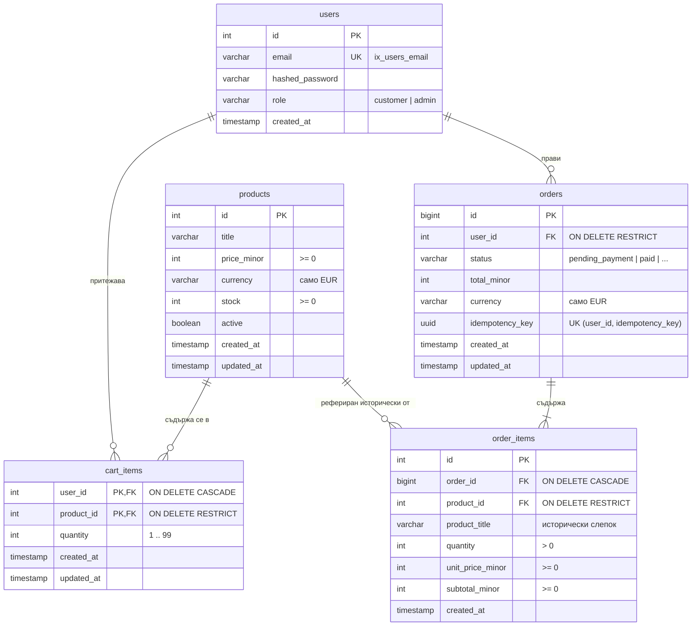

#### Диаграма 2: Плащания, Webhook събития и Transactional Outbox
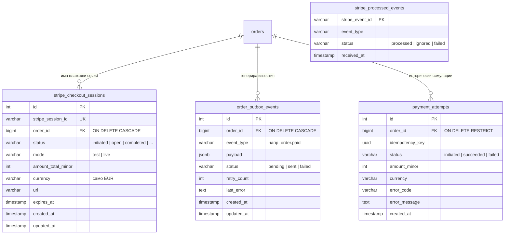

### 4.2. Спецификация на ограниченията и бизнес правила

| Таблица | Име на ограничението | Тип | Защитено бизнес правило | Къде е дефинирано |
| :--- | :--- | :--- | :--- | :--- |
| `users` | `ix_users_email` | `UNIQUE INDEX` | Забрана за дублиране на потребителски имейли в системата | ORM & миграция `4f6d091ef23b` |
| `products` | `ck_products_price_minor_non_negative` | `CHECK` | Цената не може да бъде отрицателна (`price_minor >= 0`) | ORM & миграция `6012480838e5` |
| `products` | `ck_products_stock_non_negative` | `CHECK` | Наличността в склада не може да пада под 0 (`stock >= 0`) | ORM & миграция `6012480838e5` |
| `products` | `ck_products_currency_eur` | `CHECK` | Поддържа се единствено валута евро (`currency = 'EUR'`) | ORM & миграция `6012480838e5` |
| `cart_items` | `pk_cart_items` | `PRIMARY KEY` | Съставен ключ `(user_id, product_id)`: уникална позиция за потребител | ORM & миграция `e1a7b824589d` |
| `cart_items` | `ck_cart_items_quantity_range` | `CHECK` | Количеството в количката е строго между 1 и 99 | ORM & миграция `e1a7b824589d` |
| `cart_items` | `fk_cart_items_user_id` | `FOREIGN KEY` | При изтриване на потребител количката се изчиства (`ON DELETE CASCADE`) | ORM & миграция `e1a7b824589d` |
| `cart_items` | `fk_cart_items_product_id` | `FOREIGN KEY` | Забранено е изтриване на продукт от каталога, ако е в количка (`RESTRICT`)| ORM & миграция `e1a7b824589d` |
| `orders` | `uq_orders_user_id_idempotency_key` | `UNIQUE` | Един потребител не може да създаде две поръчки с един и същ UUID ключ | ORM & миграция `399ea92dfbfa` |
| `orders` | `ck_orders_currency_eur` | `CHECK` | Валутата на поръчката трябва да бъде строго `EUR` | ORM & миграция `399ea92dfbfa` |
| `order_items` | `ck_order_items_quantity_positive` | `CHECK` | Количеството на закупена позиция трябва да е `>= 1` | ORM & миграция `399ea92dfbfa` |
| `order_items` | `ck_order_items_subtotal_minor` | `CHECK` | Междинната сума не може да бъде отрицателна (`subtotal >= 0`) | ORM & миграция `399ea92dfbfa` |
| `stripe_checkout_sessions`| `uq_stripe_checkout_sessions_stripe_session_id` | `UNIQUE` | Stripe идентификаторът на сесията е уникален в цялата база | ORM & миграция `bd4c339e0dfa` |
| `order_outbox_events` | `uq_order_outbox_events_order_id_event_type` | `UNIQUE` | За една поръчка може да има точно едно събитие от тип `order.paid` | ORM & миграция `a25cf42c74e8` |

### 4.3. Разграничение: Ограничения на PostgreSQL срещу правила в Python кода
- **Наложени от PostgreSQL (база данни)**:
  - Уникалност на имейл, уникалност на `(user_id, idempotency_key)`, уникалност на `stripe_session_id` и `(order_id, event_type)`.
  - Забрана за отрицателен склад: ако два конкурентни процеса се опитат да намалят наличността на продукт с оставащи 2 броя съответно с 2 и 1, транзакцията, опитала да свали склада на `-1`, ще се провали с `CheckViolationError` в самата база данни, защитавайки системата от свръхпродажба (overselling).
  - Релационна цялост (FK): невъзможност за осиротяване на записи.
- **Наложени само в Python кода**:
  - Минимална дължина на паролата (15 символа) и валидация на имейл формат (Pydantic EmailStr).
  - Нормализация на имейла (trim и lowercase) преди запис и търсене.
  - Скриване на неактивни продукти (`active = false`) в публичните GET заявки (връща 404).
  - Проверка дали поръчката принадлежи на текущия автентикиран потребител преди отказ или генериране на плащане.
  - Изчисляване на междинните суми в количката и проверка за достатъчна наличност преди оформяне.

### 4.4. Механика на складовата наличност (`stock`): Резервиране, намаляване и връщане
- **При добавяне в количка**: Складът **НЕ се променя и НЕ се резервира**. Количката е просто списък с желания.
- **При оформяне на поръчка (`POST /orders`)**:
  - Редовете на продуктите се заключват с `SELECT ... FOR UPDATE` в определен ред.
  - Проверява се дали `product.stock >= item.quantity`.
  - Изпълнява се незабавно намаляване: `product.stock -= item.quantity`. Поръчката преминава в `pending_payment`. Това представлява **твърда складова резервация**.
- **При отказ от клиента (`POST /orders/{id}/cancel`) или изтичане в Stripe (`checkout.session.expired`)**:
  - Наличността се връща обратно в каталога: `product.stock += item.quantity`.
  - Връщането на наличност е гарантирано дори ако артикулът междувременно е бил деактивиран от администратор (`active = false`).

### 4.5. Исторически слепок на цени и данни в `OrderItem`
Един от критичните бизнес компромиси в електронната търговия е опасността от промяна на цените в каталога със задна дата.
В таблица `order_items` се запазва пълен **исторически слепок**:
- `product_title`: Заглавието на продукта в момента на покупката. Ако администраторът промени заглавието утре, издадената поръчка запазва оригиналния текст.
- `unit_price_minor`: Единичната цена в центове в момента на покупката.
- `subtotal_minor`: Фиксираното произведение от количеството по единичната цена.
- Дори продуктът да бъде деактивиран или изтрит от каталога в бъдеще, историческата поръчка остава напълно четима и вярна счетоводно.

### 4.6. Анализ на съответствието между ORM моделите и Alembic миграциите
При детайлния одит на кодовата база беше установено:
1. **Пълно структурно съответствие**: Всички 10 миграционни файла в `services/commerce/alembic/versions/` съответстват на ORM моделите в `models.py`.
2. **Артефактна таблица `payment_attempts`**:
   - Намира се във файл [models.py](file:///Users/kovalovdavid/Projects/ecommerce-backend/services/commerce/app/modules/orders/models.py) и миграция `399ea92dfbfa`.
   - Съществува от предишен етап на обучение, когато плащанията се симулираха вътрешно.
   - В текущата версия плащанията се управляват от `stripe_checkout_sessions`.
   - Таблицата `payment_attempts` не се използва в текущия Stripe поток, но е коректно запазена в базата данни, за да не се наруши миграционната история. Това е документирано поведение, а не дефект.

---

## 5. Архитектурен дизайн, комуникационни протоколи и зависимости

### 5.1. Mermaid компонентна диаграма
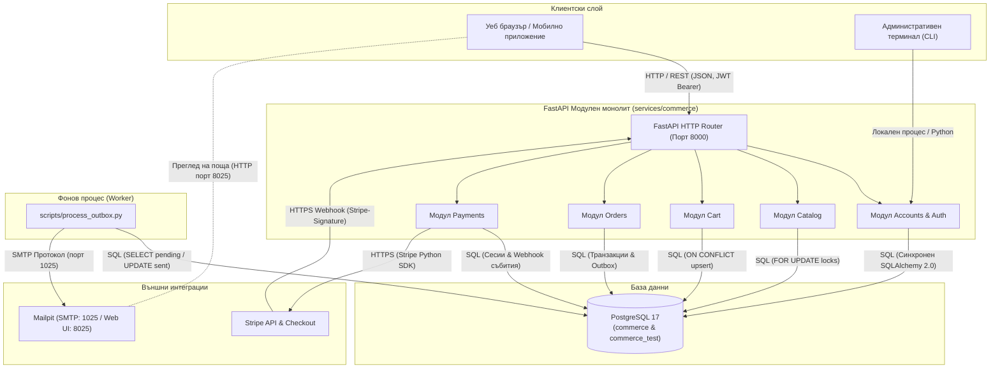

### 5.2. Посока на зависимостите в кода
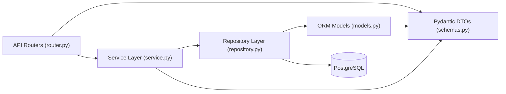

### 5.3. Архитектурни шаблони
1. **Dependency Injection (FastAPI Depends)**:
   - Използва се на входа на API за инжектиране на база-сесия (`DbSession`), удостоверяване на потребител (`CurrentUserDep`) и проверка на администраторски права (`AdminUserDep`).
   - Намалява шаблонния код (boilerplate) в рутерите и гарантира затварянето на ресурсите.
2. **Repository Pattern**:
   - Всеки домейн има свой клас за достъп до данни (`ProductRepository`, `OrderRepository` и т.н.).
   - Капсулира сложните SQL изрази, специфичните PostgreSQL клаузи (`FOR NO KEY UPDATE`, `ON CONFLICT DO UPDATE`) и елиминира дублирането на заявки.
3. **Service / Use-Case Layer**:
   - Цялата оркестрация и бизнес правила се намират тук.
   - Сервизният метод отваря логическата транзакция, извиква репозиторитата, валидира състоянията и извършва `commit` или `rollback`.
4. **Transactional Outbox Pattern**:
   - Решава фундаменталния проблем за разпределени транзакции между релационна база и външен брокер/имейл сървър.
   - Промяната на състоянието на поръчката към `paid` и записът на известието в `order_outbox_events` се извършват в **една и съща атомарна SQL транзакция**.
   - Невъзможно е поръчката да бъде платена, а събитието да се загуби.
5. **Idempotency (Идемпотентност)**:
   - При оформяне на поръчка: уникален индекс по `(user_id, idempotency_key)` връща същата поръчка при мрежов повторен опит.
   - При webhook обработка: записът в `stripe_processed_events` гарантира, че повторно доставено събитие от Stripe се маркира като пренебрегнато (`ignored`).
   - При отказ от поръчка: повторен отказ на вече отказана поръчка връща успех без повторно връщане на наличност.

### 5.4. Честна оценка спрямо Clean Architecture и SOLID принципите
> [!NOTE]
> Архитектурата на `ecommerce-backend` е **прагматична и ориентирана към висока надеждност**, а не към сляпо академично следване на Clean Architecture или чист SOLID.

- **Къде принципите са спазени отлично**:
  - *Single Responsibility Principle (SRP)*: Рутерите се грижат само за HTTP превода, сервизите — само за бизнес правилата, репозиторитата — само за SQL заявките.
  - *Separation of Concerns*: Разделянето между фоновия worker и уеб сървъра предотвратява блокиране на API при външни мрежови забавяния.
- **Съществуващи компромиси спрямо Clean Architecture**:
  - *Липса на чисти Domain Entities*: В Clean Architecture бизнес същностите са чисти Python класове без зависимости от външни библиотеки. В нашия проект ORM моделите наследяват директно SQLAlchemy `DeclarativeBase`. Сервизният слой оперира директно с тези ORM обекти.
  - *Директна зависимост на Pydantic схемите от ORM обектите*: Pydantic моделите използват `from_attributes = True`, четейки атрибутите директно от SQLAlchemy обектите.
  - *Инверсия на зависимостите (Dependency Inversion)*: Сервизите не зависят от абстрактни интерфейси (Protocols/ABCs), а инстанцират конкретни репозиторита, подавайки им общата SQLAlchemy `Session`. Това е напълно оправдано решение за модулен монолит, спестяващо излишни слоеве от абстракции.

---

## 6. Проследяване на бизнес сценариите през кода

### 6.1. Сценарий 1: Задаване на количество в количката (`PUT /cart/items/{id}`)
1. **API**: `set_cart_item_quantity_endpoint` в `modules/cart/router.py`.
2. **Автентикация**: `CurrentUserDep` извлича `user` от токена.
3. **Service**: `CartService.set_item_quantity(user_id, product_id, quantity)`:
   - Извиква `UserRepository.lock_user_for_cart_update(user_id)`: изпълнява `SELECT 1 FROM users WHERE id = :id FOR NO KEY UPDATE`. Това предотвратява паралелни колизии в количката на същия потребител.
   - Извиква `ProductRepository.get_product_by_id(product_id)`:
     - Ако липсва или `active = false` -> хвърля `ProductNotFoundError` (API връща 404).
     - Ако `quantity > product.stock` -> хвърля `InsufficientStockError` (API връща 409).
4. **Repository**: `CartRepository.upsert_item(user_id, product_id, quantity)`:
   - Изпълнява SQL: `INSERT INTO cart_items (user_id, product_id, quantity) VALUES (...) ON CONFLICT (user_id, product_id) DO UPDATE SET quantity = EXCLUDED.quantity`.
5. **Commit**: `session.commit()` финализира операцията.
6. **Резултат**: `CartService.get_cart(user_id)` зарежда обновената количка и я връща на клиента с `200 OK`.

### 6.2. Сценарий 2: Оформяне на поръчка (`POST /orders` с `Idempotency-Key`)
1. **API**: `create_order_endpoint` в `modules/orders/router.py`. Валидира наличието на UUID v4 в хедъра `Idempotency-Key`.
2. **Service**: `OrderService.create_order_from_cart(user_id, idempotency_key)`:
   - Проверява `OrderRepository.get_by_idempotency_key(user_id, idempotency_key)`. Ако поръчката вече съществува -> веднага връща съществуващата поръчка с `201 Created` (идемпотентност).
   - Заключва потребителя: `UserRepository.lock_user_for_cart_update(user_id)`.
   - Зарежда позициите: `CartRepository.get_items_by_user_id(user_id)`. Ако количката е празна -> хвърля `CartEmptyError` (API връща 409).
   - Сортира `product_ids = sorted([item.product_id for item in cart_items])`.
   - Заключва продуктите: `ProductRepository.get_products_for_update(product_ids)` чрез `SELECT ... FROM products WHERE id IN (...) ORDER BY id ASC FOR UPDATE`.
     - *Защо е важно сортирането?* Ако транзакция А заключи продукт 1, а после иска продукт 2, докато паралелна транзакция Б заключи продукт 2 и иска продукт 1, се получава мъртва хватка (deadlock). Сортирането по ID възходящо елиминира тази опасност.
   - Проверява дали всички продукти са активни и дали `product.stock >= item.quantity`.
   - Създава поръчка: `OrderRepository.create_order(...)` в статус `pending_payment`.
   - За всяка позиция:
     - Намалява склада: `product.stock -= item.quantity`.
     - Записва слепок: `OrderRepository.create_order_item(...)`.
   - Изчиства количката: `CartRepository.clear_cart(user_id)`.
3. **Commit**: `session.commit()`.
4. **Резултат**: Клиентът получава създадената поръчка с детайлен списък от артикули и статус `pending_payment` (`201 Created`).

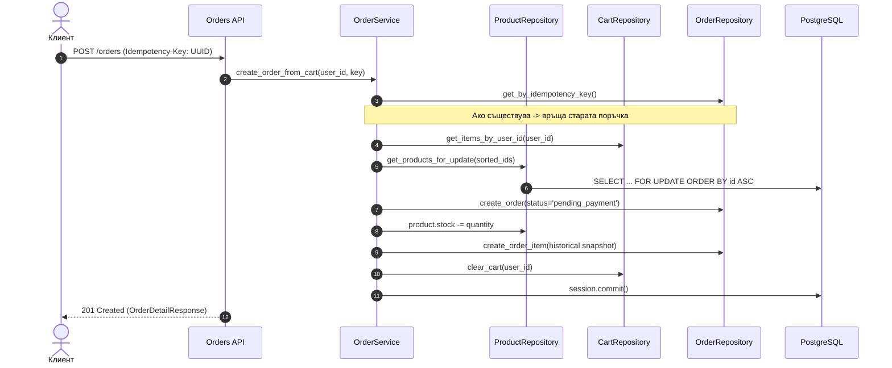

### 6.3. Сценарий 3: Създаване на Stripe Checkout Session (`POST /orders/{id}/checkout-session`)
1. **API**: `create_checkout_session_endpoint` в `modules/payments/router.py`.
2. **Service**: `StripePaymentService.create_checkout_session(user_id, order_id)`:
   - Извлича поръчката: `OrderRepository.get_by_id_for_update(order_id)`.
   - Проверява дали поръчката принадлежи на потребителя и дали статусът е `pending_payment`.
   - Проверява дали вече има активна сесия: `StripeCheckoutSessionRepository.get_latest_active_session_for_order(order_id)`. Ако има валидна сесия, която не е изтекла, връща нейния съществуващ URL без ново извикване към Stripe.
   - **Мрежово извикване извън DB транзакция**: Извиква външното Stripe API:
     ```python
     stripe.checkout.Session.create(
         payment_method_types=["card", "sepa_debit"],
         line_items=[...],
         mode="payment",
         success_url=...,
         cancel_url=...,
         metadata={"order_id": str(order_id), "user_id": str(user_id)}
     )
     ```
   - Записва сесията: `StripeCheckoutSessionRepository.create(...)` със статус `initiated` и върнатия `url`.
3. **Commit**: `session.commit()`.
4. **Резултат**: Клиентът получава URL към платежната страница на Stripe (`201 Created`).

### 6.4. Сценарий 4: Незабавна и отложена успешна оплата (Stripe Webhook)
1. **API**: `stripe_webhook_endpoint` в `modules/payments/router.py`.
2. **Верификация на подпис**:
   `stripe.Webhook.construct_event(payload, sig_header, STRIPE_WEBHOOK_SECRET)`. При несъответствие хвърля 400 Bad Request.
3. **Service**: `StripePaymentService.process_webhook_event(event)`:
   - **Идемпотентност**: Проверява `StripeProcessedEventRepository.get(event_id)`. Ако събитието вече е обработено, връща `{"status": "ignored"}` веднага.
   - Заключва поръчката: `OrderRepository.get_by_id_for_update(order_id)`.
   - **Случай А (Мигновено плащане - Карти)**: Събитие `checkout.session.completed` с `payment_status == "paid"`:
     - Поръчката преминава в статус `paid`.
     - Записва outbox събитие: `OrderOutboxRepository.create_or_get_event(order_id, "order.paid", payload)`.
     - Сесията преминава в `completed`.
     - Събитието се записва в `stripe_processed_events` със статус `processed`.
     - `session.commit()`.
   - **Случай Б (Отложено плащане - SEPA / Банков превод)**:
     - При `checkout.session.completed` с `payment_status == "unpaid"`: Поръчката преминава в статус `payment_processing`.
     - При последващо събитие `checkout.session.async_payment_succeeded`: Поръчката преминава от `payment_processing` в `paid`, записва се `order.paid` в outbox таблицата и се прави `session.commit()`.

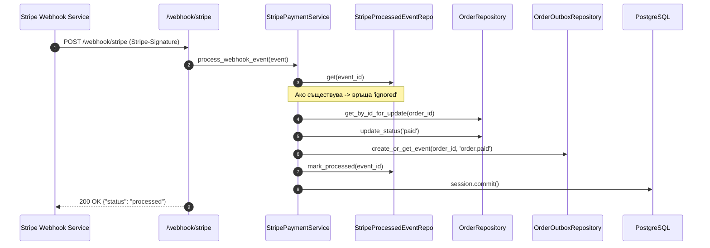

### 6.5. Сценарий 5: Отказ от поръчка и възстановяване на склад
1. **API**: `cancel_order_endpoint` в `modules/orders/router.py`.
2. **Service**: `OrderService.cancel_order(user_id, order_id)`:
   - Заключва поръчката: `OrderRepository.get_by_id_for_update(order_id)`.
   - Проверява собствеността (`order.user_id == user_id`).
   - Ако вече е `cancelled`: връща `200 OK` (идемпотентност).
   - Ако е `paid`: хвърля `OrderCancellationError("CANNOT_CANCEL_PAID_ORDER")` (API връща 409).
   - Ако е `pending_payment`:
     - Сортира артикулите по `product_id ASC`.
     - Заключва артикулите в каталога: `ProductRepository.get_products_for_update(...)`.
     - Възстановява складовата наличност: `product.stock += item.quantity`.
     - Маркира поръчката като `cancelled`.
     - Ако има активна Stripe сесия, извиква Stripe API за анулиране (`stripe.checkout.Session.expire(session_id)`).
3. **Commit**: `session.commit()`.
4. **Резултат**: Поръчката е отказана, складът е възстановен, клиентът получава статус `cancelled` (`200 OK`).

### 6.6. Сценарий 6: Записване и изпращане на `order.paid` известие (Transactional Outbox)
1. **Фаза 1: Запис (в уеб транзакцията)**:
   При преминаване на поръчката в `paid`, `OrderOutboxRepository` прави запис в `order_outbox_events` със статус `pending`, `retry_count = 0` и JSON полезен товар (имейл на клиента, номер на поръчка, сума, артикули).
2. **Фаза 2: Извличане (във фоновия worker `scripts/process_outbox.py`)**:
   - `OutboxProcessor.process_pending_events(batch_size=50)` отваря нова кратка сесия:
     ```python
     events = outbox_repo.get_pending_events(limit=50) # SELECT ... WHERE status = 'pending' ORDER BY id ASC
     ```
   - Затваря сесията (detached objects).
3. **Фаза 3: SMTP Изпращане**:
   - За всяко събитие `SmtpClient.send_email(to_email, subject, body)` осъществява връзка с Mailpit (порт 1025).
4. **Фаза 4: Отбелязване на резултата**:
   - Отваря нова кратка транзакция:
     - При успех: маркира събитието като `status = "sent"`, `updated_at = now()`. `session.commit()`.

### 6.7. Сценарий 7: Повторен опит (Retry) след SMTP грешка
1. По време на Фаза 3 от горния сценарий Mailpit е временно спрян.
2. `SmtpClient.send_email()` изхвърля `SmtpConnectionError` (Connection refused).
3. `OutboxProcessor` прехваща грешката.
4. Отваря нова сесия и обновява записа:
   - `status = "pending"` (събитието остава чакащо за повторен опит).
   - `retry_count += 1`.
   - `last_error = "Connection refused to localhost:1025"`.
   - `session.commit()`.
5. Поръчката в базата **остава със статус `paid`** — нейният бизнес статус не се компрометира от проблеми с пощенския сървър.
6. При следващото пускане на `scripts/process_outbox.py` (след възстановяване на Mailpit) събитието се прочита отново, изпраща се успешно и статусът му се променя на `sent`.

---

## 7. Управление на състоянията и частични откази

### 7.1. Диаграми на състоянията (State Diagrams)

#### Диаграма на състоянията на Поръчка (`Order`)
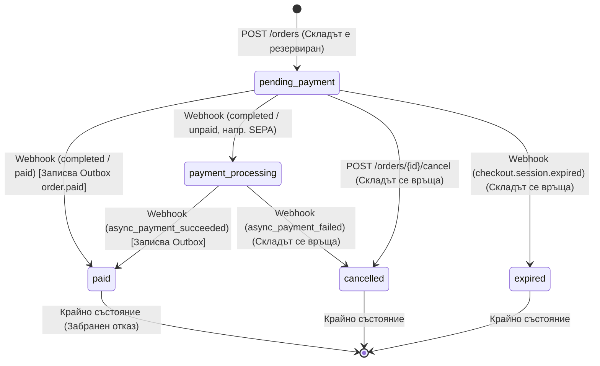

#### Диаграма на състоянията на Stripe сесия (`StripeCheckoutSession`)
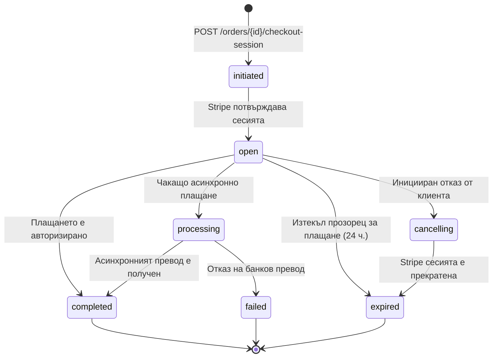

#### Диаграма на състоянията на Outbox събитие (`OrderOutboxEvent`)
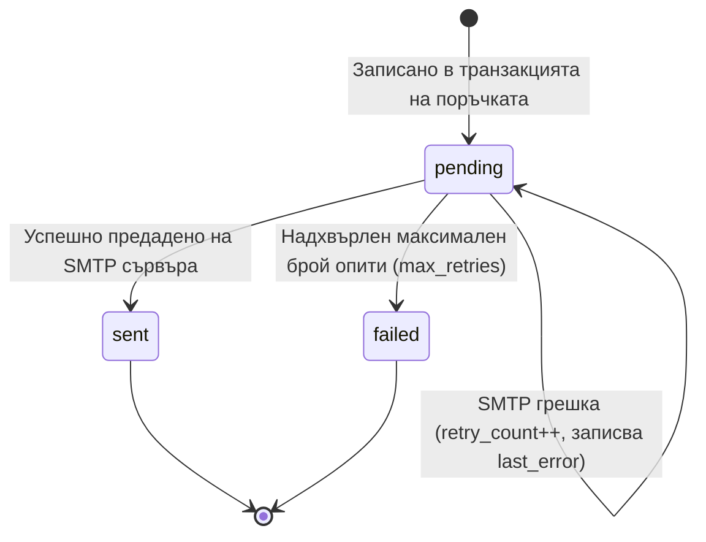

### 7.2. Обработка на повтарящи се заявки и дублирани Webhook събития
- **Дублирани клиентски заявки за поръчка**: Клиентът подава `Idempotency-Key: <UUID>`. Базата данни налага `uq_orders_user_id_idempotency_key`. При повторна заявка със същия ключ системата връща записаната вече поръчка без да променя количката и без да сваля наличност отново.
- **Дублирани Stripe Webhooks**: Stripe гарантира "at-least-once" доставка и често изпраща едно и също събитие многократно. Системата използва таблица `stripe_processed_events` с първичен ключ `stripe_event_id`. Всяко събитие се проверява преди обработка; ако вече присъства, директно се връща HTTP 200 с тяло `{"status": "ignored"}`.

### 7.3. Събития извън ред (Out-of-order events) и мрежови таймаути
- Понякога `checkout.session.completed` пристига преди локалната база да е приключила записа на сесията, или `async_payment_succeeded` изпреварва първоначалния webhook.
- Логиката в `StripePaymentService` търси поръчката директно по `order_id`, съдържащ се в метаданните на Stripe събитието, и заключва реда на поръчката с `FOR UPDATE`. Преходите на статусите са защитени от условия (напр. преход към `paid` е разрешен само от `pending_payment` или `payment_processing`). Невалиден преход не поврежда състоянието на базата.

### 7.4. Конкурентно състезание (Race Condition): Плащане срещу отказ от поръчка
- *Сценарий*: Клиентът натиска "Отказ" (`POST /orders/{id}/cancel`) в същата милисекунда, в която от Stripe пристига webhook за успешно плащане.
- *Защита*: И двата метода изпълняват `SELECT ... FROM orders WHERE id = :id FOR UPDATE`.
  - Ако първи влезе webhook-ът: поръчката става `paid`. Когато заявката за отказ получи заключването, вижда статус `paid` и хвърля `OrderCancellationError("CANNOT_CANCEL_PAID_ORDER")` (HTTP 409). Парите не се губят и складът не се връща некоректно.
  - Ако първи влезе отказът: поръчката става `cancelled` и складът се връща. Когато webhook-ът получи заключването, открива статус `cancelled`, отбелязва събитието и сигнализира за необходимост от възстановяване на средствата (refund).

### 7.5. Срив след SMTP accept преди запис на статус `sent` и At-least-once доставка
- Пощенският протокол SMTP и релационната база PostgreSQL са две физически независими системи. Между тях не може да има двуфазен commit (2PC).
- *Граничен случай*: `SmtpClient` се свързва с Mailpit, предава писмото и Mailpit връща статус `250 OK`. Точно в този момент процесът на worker-а спира аварийно (напр. срив на захранването или OOM killer), преди да успее да изпълни `UPDATE order_outbox_events SET status = 'sent'`.
- *Последица*: В базата събитието остава `pending`. При рестартиране worker-ът ще го прочете отново и ще изпрати второ писмо.
- **Извод**: Системата гарантира **At-least-once (поне веднъж)** доставка на имейлите. Потребителят може в редки форсмажорни обстоятелства да получи дублиран имейл, но е напълно невъзможно да остане без известие при платена поръчка.

---

## 8. Инструкции за стартиране, верификация и демонстрация

### 8.1. Локален запуск чрез Docker Compose
Всички Compose команди се изпълняват от **корена на хранилището**.

1. **Подготовка на `.env` файла**:
   ```bash
   test -f services/commerce/.env || cp services/commerce/.env.example services/commerce/.env
   ```
   *Забележка*: Уверете се, че `JWT_SECRET` в `services/commerce/.env` съдържа поне 32 символа.
2. **Стартиране на контейнерите**:
   ```bash
   docker compose --env-file services/commerce/.env up --build -d
   ```
3. **Проверка на адресите**:
   - **Swagger UI (Интерактивна документация)**: [http://localhost:8000/docs](http://localhost:8000/docs)
   - **OpenAPI JSON**: [http://localhost:8000/openapi.json](http://localhost:8000/openapi.json)
   - **Mailpit Web UI (Локална пощенска кутия)**: [http://localhost:8025](http://localhost:8025)

### 8.2. Тестване и верификация

#### Пускане на единичен тестов модул:
```bash
cd services/commerce
uv run --locked pytest tests/orders/test_order_notifications.py
```

#### Пълен pytest suite:
```bash
cd services/commerce
uv run --locked pytest -q
```
*Резултат*: **225 passed** (100% успеваемост).

#### Автоматизиран тест за известия и retry цикъл:
```bash
# Изпълнява се от корена на проекта:
make test-notifications-retry
```
*Какво прави командата?*
1. Вдига тестовите Docker контейнери за PostgreSQL и Mailpit.
2. Изчаква готовността на портове 5432, 1025 и 8025.
3. Симулира платена поръчка при спрян Mailpit -> проверява, че поръчката остава `paid`, а събитието получава статус `pending` със записан `last_error`.
4. Възстановява Mailpit, пуска worker-а и валидира получаването на точно едно писмо в Mailpit REST API.
5. При трето повторно пускане на worker-а доказва липсата на дублирани писма.

#### Проверка за форматиране и статичен анализ (Ruff):
```bash
cd services/commerce
uv run --locked ruff check .
uv run --locked ruff format --check .
```
*Резултат*: 100% чист код, без забележки.

### 8.3. GitHub Actions CI пайплайн: Какво се валидира автоматично
В `.github/workflows/ci.yml` е конфигуриран пълен пайплайн, който при всеки push или PR проверява:
1. **Ruff Linter & Formatter**: Проверка за код стил и статични грешки.
2. **Service Containers**: GitHub Actions вдига автоматично `postgres:17` и `axllent/mailpit:latest` като свързани контейнери с активни healthchecks.
3. **Alembic миграции**: Изпълнява се `alembic upgrade head` върху тестовата база.
4. **Тестов пакет**: Изпълнява пълния `pytest` пакет (225 теста), включително реалната доставка на писма до тестовия Mailpit контейнер. Липсата на работещ Mailpit в CI води до незабавен провал на теста (без фалшиво пропускане с `pytest.skip`).

### 8.4. Сценарий за демонстрация на живо (Walkthrough)

#### Стъпка 1: Регистрация и Вход
```bash
# 1. Регистрация
curl -s -X POST http://localhost:8000/users \
  -H "Content-Type: application/json" \
  -d '{"email": "demo.shopper@example.com", "password": "SuperSecurePassword123!"}'

# 2. Вход и извличане на токен
TOKEN=$(curl -s -X POST http://localhost:8000/auth/login \
  -H "Content-Type: application/json" \
  -d '{"email": "demo.shopper@example.com", "password": "SuperSecurePassword123!"}' \
  | python3 -c "import sys, json; print(json.load(sys.stdin)['access_token'])")
```

#### Стъпка 2: Добавяне в количката и оформяне на поръчка
```bash
# 1. Добавяне на продукт #1 (2 броя)
curl -s -X PUT http://localhost:8000/cart/items/1 \
  -H "Content-Type: application/json" \
  -H "Authorization: Bearer $TOKEN" \
  -d '{"quantity": 2}'

# 2. Оформяне на поръчка с UUID ключ
KEY=$(python3 -c "import uuid; print(uuid.uuid4())")
ORDER=$(curl -s -X POST http://localhost:8000/orders \
  -H "Content-Type: application/json" \
  -H "Authorization: Bearer $TOKEN" \
  -H "Idempotency-Key: $KEY" \
  -d '{}')
ORDER_ID=$(echo "$ORDER" | python3 -c "import sys, json; print(json.load(sys.stdin)['id'])")
echo "Създадена поръчка номер: $ORDER_ID"
```

#### Стъпка 3: Инициализация на Stripe Checkout
```bash
CHECKOUT=$(curl -s -X POST "http://localhost:8000/orders/$ORDER_ID/checkout-session" \
  -H "Authorization: Bearer $TOKEN")
echo "$CHECKOUT"
```

#### Стъпка 4: Симулация на Stripe Webhook за успешно плащане
*(В автоматизираните тестове това става чрез подписване през `stripe.Webhook.construct_event`). В базата поръчката става `paid` и в `order_outbox_events` се генерира запис.*

#### Стъпка 5: Изпълнение на Outbox Worker и проверка в Mailpit
```bash
# Изпълнение на worker-а в работещия контейнер:
docker compose --env-file services/commerce/.env exec api python scripts/process_outbox.py
```
Отворете браузъра на **[http://localhost:8025](http://localhost:8025)**:
- Ще видите получено писмо до `demo.shopper@example.com`.
- Тема: `Order #<ID> Confirmation`.
- Тяло: Съдържа номера на поръчката, форматирана обща сума в евро и списък със закупените позиции.

### 8.5. Верификация на текущото състояние
- **Проверен Commit SHA**: `958fe89bb89a4c8d1461ac073d699e0e310ea744` (съкратено: `958fe89`).
- **Разграничение на локалния резултат от CI**:
  - Локално: Всички 225 теста преминават (`225 passed in 10.37s`), Ruff е напълно чист, `make test-notifications-retry` преминава през всички стъпки без забележка.
  - В CI: GitHub Actions изпълнява същите стъпки върху Ubuntu среда с изолирани Docker containers.

---

## 9. План за изучаване и подготовка за техническо интервю

### 9.1. Препоръчителен ред за четене на кода

#### Стъпка 1: Инфраструктура на базата данни и конфигурация
- **Файлове**: [config.py](file:///Users/kovalovdavid/Projects/ecommerce-backend/services/commerce/app/config.py), [db.py](file:///Users/kovalovdavid/Projects/ecommerce-backend/services/commerce/app/db.py), [dependencies.py](file:///Users/kovalovdavid/Projects/ecommerce-backend/services/commerce/app/dependencies.py).
- **Въпроси за самопроверка**:
  1. *Защо в `sessionmaker` използваме `expire_on_commit=False`?* (Отговор: За да можем да четем атрибутите на обекта в Pydantic отговорите след края на транзакцията, без да се налага нова SQL заявка към затворена сесия).
  2. *Как `pool_pre_ping=True` предпазва от сривове при неактивност?* (Отговор: Тества връзката с лек ping преди всяко използване; ако Postgres е прекъснал TCP сокета поради таймаут, връзката се рестартира без грешка за клиента).

#### Стъпка 2: Автентикация и потребители (`accounts`)
- **Файлове**: `modules/accounts/models.py`, `service.py`, `router.py`.
- **Въпроси за самопроверка**:
  1. *Как се защитаваме от timing attacks при грешен имейл?* (Отговор: Използва се статичен dummy hash, за да се изчисли пълен Argon2id цикъл дори при несъществуващ потребител, така че времето за отговор да бъде неразличимо).
  2. *Защо паролата не присъства в JWT токена и защо ролята се чете от базата при всяка заявка?* (Отговор: За да се предотвратят атаки с подправени права или забавено отразяване на отнети роли).

#### Стъпка 3: Каталог и редови заключвания (`catalog`)
- **Файлове**: `modules/catalog/models.py`, `repository.py`, `service.py`.
- **Въпроси за самопроверка**:
  1. *Кои правила се пазят от PostgreSQL Check constraints и кои от Pydantic?* (Отговор: DB пази цената `>= 0`, склада `>= 0` и валутата `EUR`. Pydantic пази типовете, забранява празни стрингове и непознати полета).
  2. *Защо неактивен продукт връща 404 за клиент, но може да се редактира от администратор?* (Отговор: За да не се разкрива съществуването на чернови или спрени продукти пред външни потребители).

#### Стъпка 4: Количка и PostgreSQL Upsert (`cart`)
- **Файлове**: `modules/cart/models.py`, `repository.py`, `service.py`.
- **Въпроси за самопроверка**:
  1. *Защо количката не намалява наличността в склада?* (Отговор: Защото потребителят може да изостави количката; заключване на склад на този етап би блокирало продажбите за реални купувачи).
  2. *Как заявката `INSERT ... ON CONFLICT DO UPDATE` предотвратява състезание при конкурентни добавяния?* (Отговор: PostgreSQL управлява конфликта на ниво първичен ключ атомарно в рамките на една SQL операция).

#### Стъпка 5: Поръчки, Deadlock превенция и Outbox (`orders`)
- **Файлове**: `modules/orders/models.py`, `service.py`, `repository.py`, `outbox_processor.py`.
- **Въпроси за самопроверка**:
  1. *Защо продуктите се заключват със строго сортиране по ID (`ORDER BY id ASC`)?* (Отговор: За да се предотврати класически deadlock при паралелни поръчки, съдържащи едни и същи артикули в различен ред).
  2. *Как Transactional Outbox шаблонът гарантира, че няма да загубим имейл известие?* (Отговор: Записът на събитието е част от същата база-транзакция, която прави поръчката `paid`).

#### Стъпка 6: Stripe интеграция и Webhooks (`payments`)
- **Файлове**: `modules/payments/models.py`, `service.py`, `router.py`.
- **Въпроси за самопроверка**:
  1. *Защо мрежовото извикване към Stripe API се прави извън транзакцията на базата данни?* (Отговор: За да не се задържат редови заключвания в PostgreSQL при бавен мрежов отговор).
  2. *Как защитаваме Webhook рутера от подправени съобщения?* (Отговор: Чрез `stripe.Webhook.construct_event`, който проверява HMAC SHA-256 подписа с нашия `STRIPE_WEBHOOK_SECRET`).

---

### 9.2. 10 реални интервю въпроса с отговори, базирани на кода

#### Въпрос 1: Как предотвратявате свръхпродажба (overselling) при конкурентни поръчки?
**Отговор за интервю**:
В `OrderService.create_order_from_cart` прилагаме песимистично заключване (pessimistic locking). Първо извличаме идентификаторите на всички артикули в количката и ги сортираме възходящо (`sorted(product_ids)`). След това изпълняваме заявка със заключване `SELECT ... FROM products WHERE id IN (...) ORDER BY id ASC FOR UPDATE`. Сортирането гарантира, че всички паралелни транзакции заключват редовете в един и същ ред, елиминирайки възможността за deadlock. Едва след придобиване на заключването проверяваме дали `stock >= quantity`, намаляваме наличността директно в обекта и записваме поръчката. Допълнително, на ниво PostgreSQL имаме Check constraint `ck_products_stock_non_negative`, който физически отхвърля всяка транзакция, опитала се да свали склада под нула.

#### Въпрос 2: Как е реализирана идемпотентността при създаване на поръчка?
**Отговор за интервю**:
Клиентът е длъжен да изпрати хедър `Idempotency-Key` с валиден UUID v4. В базата данни имаме съставен уникален индекс `uq_orders_user_id_idempotency_key (user_id, idempotency_key)`. В началото на сервизния метод проверяваме дали вече съществува поръчка за този потребител с този ключ. Ако съществува, веднага връщаме съществуващата поръчка със статус 201 Created, без да пипаме склада и без да променяме количката. Това предпазва от дублирани плащания при мрежов таймаут и повторно изпращане от страна на мобилно приложение или фронтенд.

#### Въпрос 3: Защо избрахте Transactional Outbox шаблон вместо директно изпращане на имейл или Celery задача в транзакцията?
**Отговор за интервю**:
Ако изпратим имейл през SMTP директно в транзакцията на поръчката:
1. Забавяме HTTP отговора с 500-2000 ms поради бавния мрежов протокол.
2. Държим отворена база-транзакция по време на външен мрежов I/O, което блокира връзките в пула.
3. Ако транзакцията на базата се провали след изпращането на имейла (rollback), клиентът ще получи имейл за поръчка, която реално не съществува.
Ако пък извикаме Celery/Redis задача преди `commit`, задачата може да се изпълни преди записът в базата да е видим за Celery worker-а.
Transactional Outbox решава това: записваме събитието в `order_outbox_events` в същата транзакция. Фонов процес (`scripts/process_outbox.py`) прочита събитията и ги изпраща асинхронно, гарантирайки 100% консистентност.

#### Въпрос 4: Какви са гаранциите за доставка на известията и има ли риск от дублирани имейли?
**Отговор за интервю**:
Системата осигурява "At-least-once" (поне веднъж) доставка. Worker-ът прочита събитие със статус `pending`, изпраща го по SMTP и едва след успешен отговор от пощенския сървър отваря нова транзакция, за да запише статус `sent`. Ако worker процесът се срине или връзката прекъсне точно след като SMTP сървърът е приел писмото, но преди базата да запише `sent`, събитието ще остане `pending` и ще бъде изпратено отново при следващия пуск. Това е фундаментален компромис при работа с не-транзакционни външни протоколи (SMTP не поддържа 2-Phase Commit с Postgres).

#### Въпрос 5: Как управлявате жизнения цикъл на SQLAlchemy сесиите във FastAPI?
**Отговор за интервю**:
Използваме Dependency Injection функция `get_db_session`, която извиква контекстен мениджър от нашия `Database` клас:
```python
with db.session() as session:
    yield session
```
Генераторът гарантира, че сесията се създава при постъпване на заявката и **абсолютно винаги се затваря в `finally` блока** след генериране на HTTP отговора, дори при необработено изключение. Сесията се инжектира като `DbSession` и се споделя между всички сервизи в заявката. `commit()` и `rollback()` се управляват стриктно от сервизния слой, докато репозиторитата само изпълняват заявки.

#### Въпрос 6: Защо сесията е конфигурирана с `expire_on_commit=False` и `autoflush=False`?
**Отговор за интервю**:
- `expire_on_commit=False`: По подразбиране SQLAlchemy изтрива съдържанието на атрибутите на обекта след `commit()`, за да гарантира свежи данни при следващо четене. Но във FastAPI ние връщаме ORM обекта директно към Pydantic схемата за сериализация. Ако сесията е затворена или атрибутите са изтекли, четенето би хвърлило `DetachedInstanceError` или би генерирало паразитна SQL заявка. Затова запазваме заредите данни в паметта.
- `autoflush=False`: Предотвратява неочаквани междинни `FLUSH` заявки към базата преди изрично да сме подготвили цялото състояние.

#### Въпрос 7: Как защитавате системата от Timing Attacks при автентикация?
**Отговор за интервю**:
При вход (`POST /auth/login`), ако потребителят въведе несъществуващ имейл, обикновената проверка би върнала грешка 401 за части от милисекундата. Ако обаче потребителят съществува, изчисляването на Argon2id хеша отнема около 50-100 ms. Нападателят може да измери времето за отговор и да разбере кои имейли са регистрирани в системата (User Enumeration via Timing).
В `AccountService` ние поддържаме предварително подготвен статичен `DUMMY_HASH`. Когато потребителят не е намерен, ние изрично извикваме `verify_password("dummy", DUMMY_HASH)`. Така времето за отговор е абсолютно идентично независимо дали имейлът съществува.

#### Въпрос 8: Каква е разликата между `FOR UPDATE` и `FOR NO KEY UPDATE` в PostgreSQL и къде ги използвате?
**Отговор за интервю**:
- `FOR UPDATE` е най-строгото ексклузивно заключване на ред. То блокира всякакви паралелни четения с `FOR UPDATE`, `FOR SHARE` или обновявания на реда, включително външни ключове. Използваме го в каталога върху таблица `products`, където променяме колоната `stock`.
- `FOR NO KEY UPDATE` е по-слабо заключване, въведено в PostgreSQL 9.3+. То блокира други транзакции да модифицират реда, но **не блокира** паралелни транзакции, които само реферират реда през Foreign Key (т.е. не променят първичния ключ). Използваме го в `UserRepository.lock_user_for_cart_update(user_id)` — гарантираме, че количката на потребителя не се модифицира паралелно, без да пречим на други несвързани операции.

#### Въпрос 9: Защо в `CartItem` имаме каскадно изтриване (`CASCADE`) за потребителя, но `RESTRICT` за продукта?
**Отговор за интервю**:
В [models.py](file:///Users/kovalovdavid/Projects/ecommerce-backend/services/commerce/app/modules/cart/models.py):
- `user_id`: `ForeignKey("users.id", ondelete="CASCADE")`. Ако потребителят изтрие профила си (напр. по силата на GDPR), няма смисъл да пазим количката му — тя се изтрива автоматично.
- `product_id`: `ForeignKey("products.id", ondelete="RESTRICT")`. Ако продуктът е в количка на потребител, администраторът не може случайно да го изтрие с `DELETE FROM products`. Базата данни ще хвърли грешка, защитавайки целостта на данните. За правилно изваждане от продажба администраторът трябва да го деактивира с `active = false`, вместо да трие реда физически.

#### Въпрос 10: Как обработвате отложени методи за плащане в Stripe (напр. SEPA преводи)?
**Отговор за интервю**:
При кредитни карти събитието `checkout.session.completed` пристига с `payment_status = "paid"` и ние веднага маркираме поръчката като `paid`.
При банкови преводи обаче парите се изчистват след 1 до 3 работни дни. В този случай `checkout.session.completed` пристига с `payment_status = "unpaid"`. Ние превеждаме поръчката в междинен статус `payment_processing` и запазваме складовата наличност резервирана. Едва когато банката потвърди превода, Stripe изпраща асинхронно събитие `checkout.session.async_payment_succeeded`. Тогава нашият webhook обработчик превежда поръчката в `paid` и генерира събитието за имейл потвърждение. Ако преводът се провали, пристига `checkout.session.async_payment_failed`, поръчката преминава в `cancelled` и складът автоматично се връща в каталога.

---

## 10. Архитектурные диаграммы (Диаграммы)

В данном разделе представлены четыре визуальные схемы текущей архитектуры и предлагаемой модели данных, подготовленные в формате Mermaid для рендеринга непосредственно на GitHub. Текстовые пояснения и аннотации даны на русском языке, а названия таблиц, классов, методов и полей сохранены в точности, как в кодовой базе `ecommerce-backend`.

> [!NOTE]
> **Результаты сверки с кодом (уточнения к кодовой карте)**:
> 1. Файлы HTTP-маршрутов называются [api.py](services/commerce/app/modules/orders/api.py) (а не `router.py`).
> 2. Обработчик создания заказа в API называется `create_order`, который вызывает метод сервиса `OrderService.create_order`.
> 3. Логика Stripe и платежных сессий находится внутри модуля заказов ([services/commerce/app/modules/orders/](services/commerce/app/modules/orders/)), а не в отдельном пакете `payments`.
> 4. Отправка почты реализована классом `EmailSender` в модуле [services/commerce/app/modules/orders/mailer.py](services/commerce/app/modules/orders/mailer.py).
> 5. Миграции Alembic расположены по пути [services/commerce/migrations/versions/](services/commerce/migrations/versions/).

---

### Диаграмма 1. База данных сейчас (ER-диаграмма реального состояния)

Для удобства чтения схема базы данных разделена на два взаимосвязанных логических блока:
1. **Пользователи, каталог, корзина и заказы** (ядро доменной модели).
2. **Заказ, платежи и Outbox** (жизненный цикл платежей и асинхронных уведомлений).

Связующим звеном между обеими схемами выступает таблица `orders`.

#### 1.1. Схема ядра: Пользователи, каталог, корзина и заказы
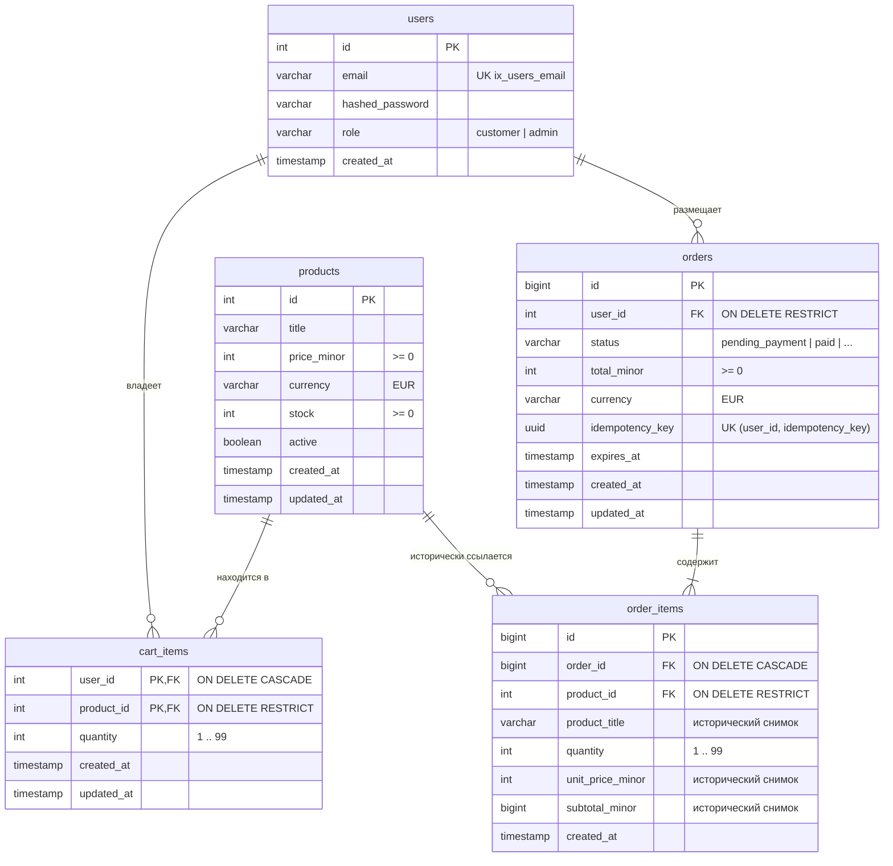

#### 1.2. Схема платежей и уведомлений: Заказ, платежи и Outbox
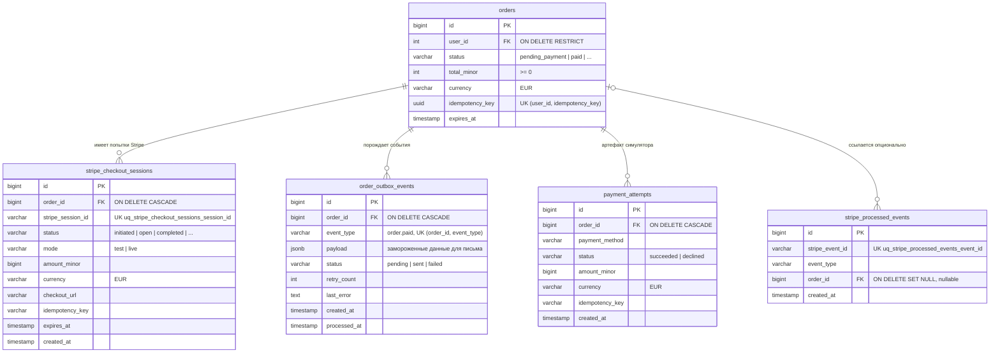

#### Легенда и анализ хранения цен и владения товаром:
- **Где лежит текущая цена товара**: В таблице `products.price_minor` (в евроцентах, целое число неотрицательное).
- **Где сохраняется цена покупки**: В таблице `order_items.unit_price_minor` (цена за 1 шт. на момент покупки) и `order_items.subtotal_minor` (итоговая стоимость позиции).
- **Почему изменение текущей цены не переписывает цену покупки**:
  При оформлении заказа метод `OrderService.create_order` читает `product.price_minor` и физически копирует это значение в новую строку таблицы `order_items`. Запись в `order_items` является неизменяемым историческим снимком (immutable snapshot). Если администратор каталога завтра изменит цену в `products.price_minor` с 14999 на 19999 центов, в `order_items` останется 14999 центов, поскольку чтение истории заказов (`GET /orders/{id}`) запрашивает данные из `order_items`, а не пересчитывает сумму динамическим соединением `JOIN` с каталогом.
- **Есть ли сейчас у товара продавец**:
  **НЕТ.** В текущей схеме базы данных у таблицы `products` нет поля `seller_id`, нет таблицы профилей продавцов и нет роли `seller`. Все товары принадлежат единому общему каталогу платформы.

Ключевые файлы:
- [services/commerce/app/modules/catalog/models.py](services/commerce/app/modules/catalog/models.py)
- [services/commerce/app/modules/cart/models.py](services/commerce/app/modules/cart/models.py)
- [services/commerce/app/modules/orders/models.py](services/commerce/app/modules/orders/models.py)
- [services/commerce/app/modules/accounts/models.py](services/commerce/app/modules/accounts/models.py)

---

### Диаграмма 2. Связи в коде сейчас (Путь POST /orders)

Диаграмма иллюстрирует сквозной путь создания заказа от входящего HTTP-запроса через зависимости FastAPI, бизнес-сервис и репозитории до таблиц PostgreSQL.

```mermaid
flowchart TD
    Client["Клиент (HTTP POST /orders с Idempotency-Key)"]
    
    subgraph FastAPI_DI["Контейнер внедрения зависимостей (FastAPI Dependencies)"]
        DBSessionProvider["get_db_session\n(открывает Session через with db.session())"]
        OrderServiceProvider["get_order_service\n(инжектирует Session в репозитории и сервис)"]
    end

    subgraph API_Layer["Слой API (Обработчик маршрута)"]
        CreateOrderHandler["create_order (app.modules.orders.api)\nPOST /orders"]
    end

    subgraph Service_Layer["Бизнес-слой (Use-Case & Транзакция)"]
        OrderServiceInstance["OrderService.create_order\n(app.modules.orders.service)"]
    end

    subgraph Repositories["Слой репозиториев (SQLAlchemy-запросы)"]
        UserRepo["UserRepository\n(app.modules.accounts.repository)"]
        OrderRepo["OrderRepository\n(app.modules.orders.repository)"]
        CartRepo["CartRepository\n(app.modules.cart.repository)"]
        ProductRepo["ProductRepository\n(app.modules.catalog.repository)"]
    end

    subgraph Database["База данных PostgreSQL"]
        T_Users[("таблица users")]
        T_Orders[("таблица orders")]
        T_OrderItems[("таблица order_items")]
        T_CartItems[("таблица cart_items")]
        T_Products[("таблица products")]
    end

    Client -->|1. HTTP-запрос POST /orders| CreateOrderHandler
    
    DBSessionProvider -.->|передаёт зависимость Session| OrderServiceProvider
    OrderServiceProvider -.->|передаёт зависимость OrderService| CreateOrderHandler
    
    CreateOrderHandler -->|2. вызывает метод| OrderServiceInstance

    OrderServiceInstance -->|3. блокирует пользователя: lock_by_id| UserRepo
    UserRepo -->|SELECT ... FOR NO KEY UPDATE| T_Users

    OrderServiceInstance -->|4. проверяет ключ идемпотентности: get_by_user_and_idempotency_key| OrderRepo
    OrderRepo -->|SELECT WHERE user_id AND idempotency_key| T_Orders

    OrderServiceInstance -->|5. читает корзину: list_by_user_id| CartRepo
    CartRepo -->|SELECT ... WHERE user_id| T_CartItems

    OrderServiceInstance -->|6. блокирует товары: get_by_ids_for_update| ProductRepo
    ProductRepo -->|SELECT ... FOR UPDATE ORDER BY id ASC| T_Products

    OrderServiceInstance -->|7. создаёт заказ: add| OrderRepo
    OrderRepo -->|INSERT INTO orders status=pending_payment| T_Orders

    OrderServiceInstance -->|8. сохраняет позиции: add_item| OrderRepo
    OrderRepo -->|INSERT INTO order_items снимок цен| T_OrderItems

    OrderServiceInstance -->|9. уменьшает остаток: product.stock -= qty| ProductRepo
    ProductRepo -->|UPDATE products SET stock = ...| T_Products

    OrderServiceInstance -->|10. очищает корзину: clear_by_user_id| CartRepo
    CartRepo -->|DELETE FROM cart_items WHERE user_id| T_CartItems

    OrderServiceInstance -->|11. фиксирует транзакцию: session.commit()| Database
```

#### Легенда к потоку вызовов:
- Сплошные стрелки (`-->`) обозначают **вызовы методов** с передачей параметров.
- Пунктирные стрелки (`-.->`) обозначают **внедрение зависимостей (Dependency Injection)** через `FastAPI Depends`.
- **Источник сессии БД**: Функция `app.dependencies.get_db_session` открывает контекстный менеджер `with db.session() as session:`, создавая единую сессию на запрос. Функция `get_order_service` передаёт эту же сессию во все репозитории и в `OrderService`.
- **Кто выполняет commit**: Только **`OrderService.create_order`** вызывает `session.commit()` (или `session.rollback()` при ошибке). Репозитории выполняют только запросы, `add()` и `flush()`, не выполняя commit самостоятельно.

Ключевые файлы:
- [services/commerce/app/modules/orders/api.py](services/commerce/app/modules/orders/api.py)
- [services/commerce/app/modules/orders/dependencies.py](services/commerce/app/modules/orders/dependencies.py)
- [services/commerce/app/modules/orders/service.py](services/commerce/app/modules/orders/service.py)
- [services/commerce/app/modules/orders/repository.py](services/commerce/app/modules/orders/repository.py)

---

### Диаграмма 3. Оплата и письмо (Stripe Webhook и Transactional Outbox)

Диаграмма отражает обработку подтверждения оплаты и последующую асинхронную отправку email-уведомления фоновым процессом.

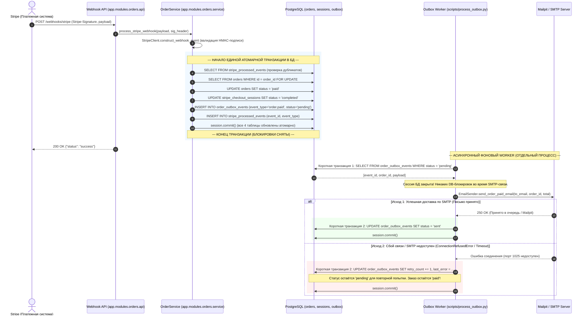

#### Легенда и архитектурные гарантии:
- **Транзакционная граница**: Перевод заказа в статус `paid`, обновление сессии в `completed`, дедупликация в `stripe_processed_events` и запись события в `order_outbox_events` происходят в **одной неделимой транзакции PostgreSQL**. Потерять событие при сбое сети невозможно.
- **Отказ от микросервисов**: Процесс отправки уведомлений (`scripts/process_outbox.py`) **НЕ является отдельным микросервисом**. Это фоновый воркер (worker process), разделяющий ту же кодовую базу `services/commerce` и ту же базу данных.
- **Разделение I/O и блокировок**: Во время сетевого обращения к SMTP-серверу сессия PostgreSQL **закрыта**. База данных не держит открытых транзакций при медленном ответе почтового сервера.
- **Два исхода alt**:
  1. *Успех*: статус события становится `sent`, писмо доставлено.
  2. *Сбой связи*: статус события остаётся `pending`, счётчик `retry_count` увеличивается, сохраняется `last_error`. Заказ остаётся `paid`, а событие будет повторено при следующем запуске воркера.

Ключевые файлы:
- [services/commerce/app/modules/orders/api.py](services/commerce/app/modules/orders/api.py)
- [services/commerce/app/modules/orders/service.py](services/commerce/app/modules/orders/service.py)
- [services/commerce/app/modules/orders/outbox_processor.py](services/commerce/app/modules/orders/outbox_processor.py)
- [services/commerce/app/modules/orders/mailer.py](services/commerce/app/modules/orders/mailer.py)
- [services/commerce/scripts/process_outbox.py](services/commerce/scripts/process_outbox.py)

---

### Диаграмма 4. Продавцы и владение товаром (Предлагаемая модель данных)

> [!IMPORTANT]
> **Предложение для следующего этапа — ещё не реализовано.**  
> Данная модель показывает минимальное расширение существующей архитектуры для поддержки маркетплейса с продавцами без ломающих изменений базовых покупок.

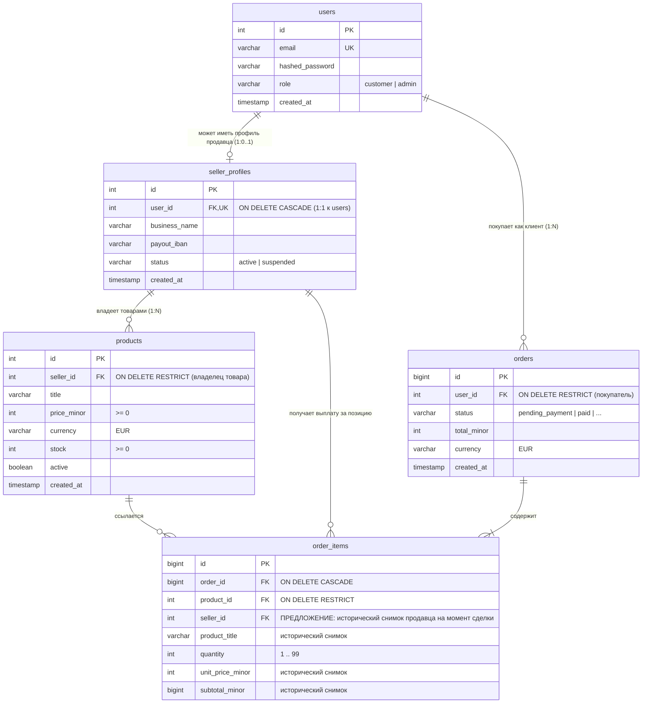

#### Анализ на примере: Анна и Борис — продавцы
Предположим, Анна (`seller_id = 10`) и Борис (`seller_id = 20`) зарегистрированы как продавцы. Анна хочет изменить цену на свой товар (Товар А, `id = 101`, `seller_id = 10`). Почему она может это сделать, но не может изменить цену Товара Б (`id = 102`, `seller_id = 20`), принадлежащего Борису?

1. **Что гарантирует внешний ключ (FK) в базе данных**:
   Ограничение `FOREIGN KEY (seller_id) REFERENCES seller_profiles(id)` на уровне PostgreSQL гарантирует исключительно **ссылочную целостность** (referential integrity):
   - Товар не может быть создан с несуществующим `seller_id`.
   - Профиль продавца нельзя удалить из базы, пока в каталоге числятся его товары (`ON DELETE RESTRICT`).
   - **FK НЕ проверяет личность и права автора HTTP-запроса!** Если отправить в базу SQL-команду `UPDATE products SET price_minor = 500 WHERE id = 102`, база данных успешно выполнит её независимо от того, кто выполнил запрос.
2. **Что обязан проверить Service при авторизованном запросе**:
   Проверка прав владения лежит целиком на **сервисном слое** (`CatalogService` / `ProductService`):
   - Из проверенного JWT-токена Анны извлекается её `current_user.id`.
   - Сервис находит её профиль продавца: `seller = seller_repository.get_by_user_id(current_user.id)` (получает `seller.id == 10`).
   - Сервис загружает целевой товар: `product = product_repository.get_by_id(product_id)`.
   - Сервис выполняет проверку владения:
     ```python
     if product.seller_id != seller.id:
         raise PermissionDenied("You do not own this product")
     ```
   - На границе API это доменное исключение перехватывается и преобразуется в HTTP-ответ **`403 Forbidden`** (`FORBIDDEN_NOT_SELLER_OWNER`).
3. **Роль Администратора**:
   Администратор платформы (`role = 'admin'`) обладает **правом модерации**, а не правом владения:
   - Администратор может заблокировать (`active = false`), снять с публикации контрафактный товар или заморозить профиль продавца-нарушителя.
   - Но администратор **не является владельцем всех товаров**, и выручка от продажи товара Бориса не поступает администратору.
4. **Историческая фиксация продавца в заказе**:
   В таблицу `order_items` предлагается добавить снимок `seller_id`. Если продавец позже сменит юридическое лицо или закроет профиль, история заказа и расчет комиссии маркетплейса останутся привязаны к фактическому продавцу на момент совершения сделки.

Ключевые файлы для будущей реализации:
- [services/commerce/app/modules/accounts/models.py](services/commerce/app/modules/accounts/models.py)
- [services/commerce/app/modules/catalog/models.py](services/commerce/app/modules/catalog/models.py)
- [services/commerce/app/modules/catalog/service.py](services/commerce/app/modules/catalog/service.py)
- [services/commerce/app/modules/orders/models.py](services/commerce/app/modules/orders/models.py)


