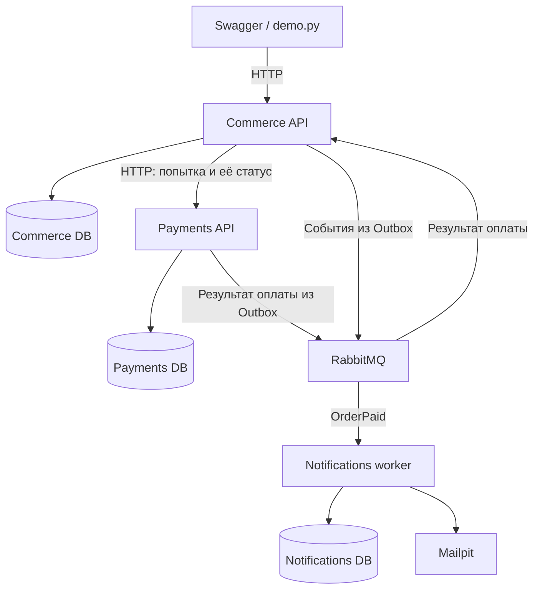

**Учебный e-commerce backend на FastAPI: план на восемь недель**

Версия плана: 16 октября 2026. Цель — самостоятельно реализовать и объяснить работающую систему. Это план работы, а не уже реализованный проект и не подтверждение его производительности.

Исходные условия: большинство знакомых инструментов пока используются с подсказками; 10–20 часов в неделю; сессия около двух часов; срок до двух месяцев; расходы на облако должны быть исключены. Планируем по 20 часам в неделю, после первых двух недель пересматриваем оценки по фактическому темпу.

Чужие сроки в неделю или месяц не дают надёжного ориентира: неизвестны опыт автора, время работы, шаблоны и глубина проверки. Наша единица прогресса — поведение, которое ты можешь реализовать, проверить, объяснить и немного изменить самостоятельно.

Я посмотрел дерево и несколько ключевых файлов map_of_popularity_api на коммите 56794ea2ee334934a6d4931a3bb258f8b5072251. В проекте есть Django REST Framework, модели локаций, отзывов и подписок, кэширование и Celery-задача отправки письма. В просмотренном дереве не обнаружены README и файлы тестов. Это чтение кода для планирования, а не полный аудит или запуск приложения. Наличие Celery в старом проекте не означает, что его нужно считать освоенным.

Источник проекта: [roadmap.sh](https://roadmap.sh/projects/scalable-ecommerce-platform).
Предыдущая работа: [map_of_popularity_api](https://github.com/DavidKovalov92/map_of_popularity_api).

**Объём определяем через один пользовательский сценарий.**

Покупатель входит в систему, выбирает товар, устанавливает количество в корзине, оформляет заказ, проходит имитацию оплаты, получает итоговый статус и уведомление. Администратор загружает небольшой набор товаров через команду подготовки демонстрационных данных. Внешний вид магазина не разрабатываем.

MVP — минимальная законченная версия, демонстрирующая этот сценарий. Первый технический этап намного меньше MVP: получение товара из PostgreSQL через API.

| Основание | Что включаем |
| --- | --- |
| Ядро исходного задания | E-commerce, микросервисная архитектура как конечная цель, контейнеризация Docker. |
| Примеры в исходном задании | Пользователи, каталог и остатки, корзина, заказы, платежи, уведомления. Это предложенные границы, которые адаптируем. |
| Инфраструктура, предложенная на странице | Gateway, discovery, централизованные логи, CI/CD, мониторинг, оркестрация. Страница перечисляет широкий набор; выбираем по необходимости. |
| Моя рекомендация для учебного MVP | Один продавец, один склад, EUR, простые товары без вариантов; вход, каталог, корзина, заказ, имитация оплаты, обработка основных сбоев. |
| Учебный релиз с микросервисами | Commerce, Payments, Notifications с отдельным владением данными, HTTP и событиями. |
| Следующие версии | Настоящий sandbox провайдера, возвраты, отмена оплаченного заказа, доставка, несколько складов, выделение Catalog/Inventory/Identity, поиск и кэш по измерениям. |

В MVP также входят история собственных заказов, проверки доступа, миграции, тесты ключевых сценариев, повторяемый запуск и инструкция демонстрации. Сложные скидки, налоги, валютная конвертация, маркетплейс и полноценная админка остаются за пределами восьми недель.

Демонстрация: Swagger UI по /docs, небольшой scripts/demo.py с HTTP-запросами и проверками, подготовленные товары и два тестовых покупателя. Для уведомлений — локальный Mailpit, который принимает тестовые письма и показывает их в браузере. Сценарий должен занимать 3–5 минут.

**Архитектура развивается вместе с работающими сценариями.**

Модульный монолит — одно запускаемое приложение с чёткими внутренними модулями. Микросервис — отдельно запускаемый и развёртываемый компонент с собственной ответственностью и данными.

| Путь | Польза | Цена | Решение |
| --- | --- | --- | --- |
| Сразу 6 сервисов | Раннее знакомство с сетью и распределёнными сбоями | До первой покупки нужны несколько приложений, контрактов, миграций, конфигураций и механизмов восстановления | Для текущего опыта слишком много одновременно меняющихся частей |
| Сначала модули, затем выделение | Сначала понимаешь сценарий и транзакции, затем видишь, что меняется при появлении сети | При выделении придётся изменить вызовы, хранение и тесты | Рекомендую этот путь; выделение сервисов — отдельный запланированный этап |

Начальные модули: accounts, catalog, cart, orders, payments. Уведомления добавляем после рабочего заказа. В учебном релизе остаются три компонента:

| Компонент | Ответственность | Его данные |
| --- | --- | --- |
| Commerce API | Пользователи, каталог, корзина, резервирование товара, жизненный цикл заказа | users, products, inventory, carts, cart_items, orders, order_items, reservations, idempotency_records, outbox/inbox |
| Payments API и его worker | Платёжные попытки, обращение к имитатору провайдера, выяснение результата после таймаута | payment_attempts, provider_operations, outbox |
| Notifications worker | Получение события об оплаченном заказе, подготовка и отправка тестового письма | inbox, deliveries |

У Commerce модули логически владеют своими таблицами. Оплата и уведомления после выделения имеют отдельные базы и учётные записи. Для экономии все базы могут находиться в одном экземпляре PostgreSQL. Это общий сервер, но сервисы не читают чужие таблицы и не имеют межсервисных внешних ключей. Внешний ключ — ограничение БД, связывающее запись с существующей записью другой таблицы.

Accounts, Catalog, Cart и Orders пока остаются в Commerce. Выделение их в отдельные сервисы — будущий учебный шаг. В README честно описываем эту архитектуру и её границы.



Диаграмма показывает целевое состояние учебного релиза. В первом этапе присутствуют только Commerce и PostgreSQL.

HTTP используем там, где нужен непосредственный ответ: чтение товара, изменение корзины, создание платёжной попытки, запрос её состояния. Событие — сообщение об уже случившемся факте, например PaymentSucceeded или OrderPaid. События используем для передачи результата оплаты и запуска уведомления, когда обработка может завершиться позже.

Commerce возвращает заказ в состоянии ожидания, а клиент проверяет GET /orders/{id}. Успешный HTTP-ответ на создание платёжной попытки ещё не означает успешную оплату. Асинхронность бизнес-процесса через сообщения не требует писать весь Python-код через async/await.

Решения в начале: сценарий MVP; EUR; деньги в целых центах; кто владеет данными; покупатель видит только свои записи; статусы заказа; атомарность резервирования; семантика повторного checkout; одно репо и небольшие ветки. Решения позже: конкретная очередь и формат событий перед выделением, параметры повторов по экспериментам, облачный инстанс по потреблению памяти, кэш по замерам, выделение остальных сервисов по учебной задаче.

**Стек добавляем тогда, когда появляется работа для компонента.**

| Когда | Компонент | Задача |
| --- | --- | --- |
| Этап 1 | Python 3.13, uv, pyproject.toml и lock-файл | Зафиксировать среду и воспроизводимо устанавливать зависимости |
| Этап 1 | FastAPI, Uvicorn, Pydantic 2 | HTTP API, сервер запуска, проверка входа и формы ответа |
| Этап 1 | PostgreSQL, SQLAlchemy 2, psycopg 3 | Постоянное хранение, SQL-запросы, ограничения и транзакции |
| Этап 1 | Alembic | Версионировать изменения схемы БД — миграции |
| Этап 1 | pytest, HTTPX/TestClient, Ruff | Проверять поведение API, форматировать код и находить простые ошибки |
| Этап 1 | Docker Compose, Dockerfile, GitHub Actions | Одинаково запускать окружение; автоматически выполнять проверки после push/PR |
| Этап 2 | pwdlib с Argon2, PyJWT | Хэши паролей и короткоживущий подписанный токен входа |
| Этап 4 | Небольшой worker, читающий сохранённые незавершённые операции из PostgreSQL | Восстанавливать работу после перезапуска и выяснять результаты оплаты |
| Этап 5 | HTTPX Client с ограниченными таймаутами | Вызовы выделенного Payments |
| Этап 6 | RabbitMQ и Pika | Доставка событий и явное изучение подтверждения обработки |
| Этап 6 | Mailpit | Демонстрация писем без реальных почтовых отправок |
| Этап 7 | Структурированные логи, prometheus-client, Locust | Наблюдать задержки, ошибки и очереди; запускать нагрузочный сценарий |
| Этап 7 | Caddy, если есть публичный HTTPS-хост | Завершение TLS и проксирование публичного трафика |

Для начала рекомендую синхронный SQLAlchemy и обычные def-обработчики FastAPI. Так легче проследить вызовы и транзакции. FastAPI выполняет такие обработчики в пуле потоков. Блокирующие запросы к БД не переносим напрямую в async def. Async-версию изучим отдельным изменением, если появится соответствующая задача. [Документация FastAPI](https://fastapi.tiangolo.com/async/).

Redis пока не нужен: корзину храним в PostgreSQL, данные каталога получаем обычными запросами. Celery тоже откладываем: здесь учебная цель — события и явные подтверждения через RabbitMQ/Pika. Позже Celery можно рассмотреть для самостоятельных фоновых задач. Не требуется одновременно осваивать оба способа выполнения одной работы.

Kubernetes/EKS, Kafka, Elasticsearch, Consul, сервисная сетка, gRPC, Terraform и универсальный API Gateway в восьминедельный релиз не входят. Compose даёт имена сервисов для связи в одном окружении. Для публичного входа достаточно обычного reverse proxy — сервера, передающего запрос в приложение.

**Код организуем по бизнес-модулям с небольшим числом слоёв.**

Monorepo означает один Git-репозиторий для нескольких компонентов. Каталоги создаём по мере появления кода.

| Путь в будущем репозитории | Содержимое |
| --- | --- |
| README.md | Что умеет версия, запуск, демонстрация и ограничения |
| compose.yaml | Приложения, БД, затем брокер и Mailpit |
| services/commerce/ | Начальное приложение, позднее основной сервис |
| services/payments/ | Появляется при выделении оплаты |
| services/notifications/ | Появляется при выделении уведомлений |
| services/<service>/pyproject.toml и uv.lock | Зависимости конкретного сервиса |
| services/<service>/migrations/ | Миграции его базы |
| tests/e2e/ | Проверки полного сценария через публичные интерфейсы |
| scripts/demo.py | Воспроизводимая демонстрация |
| docs/scope.md, docs/architecture.md | Границы версии и актуальная схема |
| docs/adr/ | Короткие записи существенных архитектурных решений |
| docs/performance.md, docs/progress.md | Условия и результаты замеров; текущий следующий шаг |
| .github/workflows/ci.yml, .env.example | Автоматические проверки; имена настроек без секретов |

Пример внутри services/commerce:

| Путь | Ответственность |
| --- | --- |
| src/commerce/main.py | Создать приложение и подключить маршруты |
| src/commerce/config.py, db.py | Настройки и создание соединений/сессий |
| src/commerce/modules/cart/api.py | HTTP, текущий пользователь, перевод ошибок в ответы |
| src/commerce/modules/cart/schemas.py | Формы входных и выходных JSON |
| src/commerce/modules/cart/service.py | Сценарии использования: установить количество, получить корзину |
| src/commerce/modules/cart/domain.py | Чистые правила: допустимое количество, ограничения |
| src/commerce/modules/cart/repository.py | Конкретные запросы к PostgreSQL |
| src/commerce/modules/cart/models.py | ORM-описания таблиц |
| tests/unit/, tests/integration/ | Проверки правил и работы с настоящей БД |

ORM — способ описать таблицы и запросы средствами Python. Сценарий использования — законченная операция пользователя, например «оформить заказ».

API вызывает service; service вызывает правила domain и функции repository; repository использует ORM. Domain не зависит от HTTP и БД. HTTPException остаётся в API, SQL не помещаем в обработчики HTTP.

На этом этапе service может явно работать с SQLAlchemy Session. Это осознанная зависимость от библиотеки хранения: нам легче видеть транзакцию. Не обещаем полную независимость от ORM. Собственный абстрактный Repository, базовый CRUDService и отдельный универсальный UnitOfWork пока не нужны. Небольшой интерфейс платёжного клиента появится при реальной замене локального вызова на HTTP.

Транзакция — группа изменений БД, которая сохраняется целиком или отменяется целиком. Ею управляет сценарий использования. Repository делает запросы, но не вызывает отдельный commit для каждой записи. У заказа, резервирования и записи Outbox может быть один commit, пока они принадлежат одной БД Commerce. Запросы к провайдеру оплаты не выполняются под длительными блокировками БД.

**Checkout проектируем вокруг денег, запасов и восстановления.**

Деньги: price_minor = 1299 означает 12,99 EUR. Float для суммы заказа не используем. Цена приходит из каталога на сервере, а не из тела запроса покупателя. В order_items сохраняем снимок названия, количества и цены: последующие изменения каталога не меняют оформленный заказ.

Корзина не резервирует товар. При checkout сервер повторно читает актуальные цены и остатки. Клиент передаёт ожидаемую итоговую сумму и версию корзины. Если расчёт изменился, возвращаем 409 PRICE_CHANGED либо CART_CHANGED и предлагаем подтвердить новые данные. Числа клиента используются для проверки ожиданий, а не как источник цены.

Поток целевого релиза:

1. Проверяем пользователя, непустую корзину, Idempotency-Key и версию корзины.
2. В короткой транзакции Commerce блокируем корзину и строки нужных остатков в стабильном порядке; проверяем активность товаров и доступное количество.
3. Создаём заказ, снимки order_items, резерв и постоянный payment_attempt_id; сохраняем идемпотентный результат. Очищаем оформленную версию корзины в той же транзакции. Сохраняем всё одним commit.
4. После commit обращаемся в Payments с тем же payment_attempt_id, order_id, суммой и EUR. Незавершённый заказ уже существует в БД: worker найдёт его, даже если процесс упадёт перед HTTP-вызовом.
5. Payments сначала сохраняет попытку, затем вызывает имитатор провайдера со стабильным идентификатором операции. Имитатор умеет успех, подтверждённый отказ и «успех произошёл, но ответ потерялся». Карточных данных и настоящих списаний нет.
6. Payments сохраняет итог и событие в своей Outbox. Событие сообщает Commerce результат; периодическая сверка статуса остаётся способом восстановления.
7. Commerce проверяет соответствие попытки, суммы и валюты. При успехе переводит заказ в paid, превращает резерв в продажу и пишет OrderPaid в одной транзакции. При окончательном отказе переводит заказ в payment_failed и освобождает резерв.
8. Notifications обрабатывает OrderPaid и формирует письмо. Недоступность почты не отменяет уже оплаченный заказ.

Остатки можно выразить как on_hand и reserved: available = on_hand - reserved; при резервировании растёт reserved, при успешной продаже одновременно уменьшаются on_hand и reserved, при отказе уменьшается только reserved. Инвариант — условие, которое должно всегда оставаться истинным: 0 <= reserved <= on_hand. Административное изменение остатка также обязано его соблюдать. Защиту от двух одновременных покупателей обеспечивает атомарный SQL или блокировка строк, а проверяем её конкурентным тестом в PostgreSQL.

Заказу достаточно pending_payment, paid, payment_failed. Неопределённость оплаты хранится в попытке оплаты как unknown; заказ при этом остаётся pending_payment. Автоматическое истечение резервов и пользовательскую отмену ожидающего заказа пока откладываем, чтобы сначала правильно разобраться с поздним успехом. Старые pending-попытки видны в метриках и доступны для явной сверки.

| Сбой или повтор | Ожидаемое поведение |
| --- | --- |
| Покупатель повторил checkout с тем же ключом и исходным запросом | Возвращается тот же order_id; нового заказа и резерва нет |
| Тот же ключ, но другое тело/версия корзины | 409 IDEMPOTENCY_CONFLICT |
| Два запроса одновременно с одним ключом | Уникальное ограничение по пользователю, операции и ключу определяет одного победителя; второй получает существующий результат либо явный ответ «обработка идёт» |
| Оплата принята, HTTP-ответ потерялся | Не считаем это отказом и не создаём новую оплату; повторяем с тем же attempt_id или запрашиваем её результат |
| Процесс упал после создания заказа, но до обращения в Payments | Worker находит незавершённый заказ и продолжает с сохранённым attempt_id |
| Payments недоступен | Заказ остаётся pending; повторы ограничены и используют тот же ключ |
| Брокер временно недоступен | Событие остаётся в Outbox до восстановления |
| Событие пришло дважды | Inbox с уникальным event_id для конкретного потребителя предотвращает повторное изменение состояния |
| Событие пришло с опозданием | Проверяются attempt_id, допустимый переход статуса и версия; paid не становится failed из-за старого сообщения |
| Почта недоступна | Повторяется только доставка письма; статус заказа сохраняется |

Идемпотентность означает одинаковый бизнес-результат при повторении одной операции. Для checkout сохраняем область действия ключа, hash исходного запроса и order_id в PostgreSQL. Результат ищем до повторного чтения уже очищенной корзины. Не ограничиваемся Python-словарём в памяти.

Outbox — таблица исходящих событий, записываемых вместе с бизнес-изменением в одной транзакции. Отдельный процесс публикует их и отмечает отправку после подтверждения брокера. Если он упадёт между публикацией и отметкой, сообщение может уйти повторно. Поэтому Outbox сочетается с дедупликацией у получателя. [Описание паттерна](https://docs.aws.amazon.com/prescriptive-guidance/latest/cloud-design-patterns/transactional-outbox.html).

Для RabbitMQ нужны устойчивые очереди, persistent-сообщения, publisher confirms и consumer acknowledgements. Последние — подтверждения публикации и обработки. Получатель подтверждает сообщение после commit. Inbox и изменение заказа сохраняются вместе. Событие содержит event_id, type, schema_version, order_id, attempt_id и нужные поля; пароль и токен в событие не попадают. Повторяем только временные ошибки с возрастающей паузой, например 1, 5, 20 секунд. После установленного числа попыток невалидное сообщение попадает в отдельную очередь ошибок и становится видимым оператору. [RabbitMQ](https://www.rabbitmq.com/docs/confirms).

Для письма внешняя SMTP-отправка и наша БД не образуют одну транзакцию. Сбой после принятия письма Mailpit, но до сохранения отметки может дать повторное письмо. Это документированное ограничение; заказ и списание товара при этом не повторяются.

Компенсация — отдельное действие, исправляющее уже сохранённый результат другого шага. В MVP это освобождение резерва при подтверждённом отказе оплаты. Таймаут сам по себе не является основанием для освобождения. Для реальной оплаченной, но невыполнимой покупки понадобится идемпотентный возврат денег; этот сценарий относится к следующей версии. Общей транзакции между сервисами не предполагаем.

**Качество проверяем по поведению и рискам.**

| Область | Минимум учебного релиза |
| --- | --- |
| Вход | Хэши Argon2 через библиотеку; короткий срок токена; проверка подписи и срока; роли buyer/admin |
| Доступ | cart/order выбираются с учётом текущего user_id; клиент не назначает себе владельца или роль |
| Границы ввода | Положительное количество, ограниченный размер корзины, предел page size, допустимые суммы; предсказуемые 401/403/404/409/422 |
| Публичный запуск | HTTPS, ограничения попыток входа и размеров запросов, только необходимые открытые порты; payment API и брокер внутри сети |
| Межсервисный доступ | Отдельный внутренний токен или иной простой механизм идентификации; отсутствие открытого endpoint для установки paid |
| Конфигурация | pydantic-settings; .env.example без значений секретов; проверка обязательных настроек при старте |
| Секреты | Вне Git, отдельно для local/test/cloud; секретные значения и карточные данные не попадают в логи |
| Миграции | Каждое изменение схемы отдельной проверенной миграцией; применение на пустой БД и на предыдущей версии |
| Ошибки | JSON с code, message, request_id; внутренний traceback только в серверном журнале |
| Логи | JSON в stdout: request_id, order_id, attempt_id, event_id, сервис, результат и длительность |
| Метрики | Частота запросов, ошибки, p95; число и возраст pending; возраст Outbox, повторы и очередь ошибок |
| Данные | Ограничения БД, backup перед изменениями, проверка восстановления небольшого дампа |

p95 — такая длительность, быстрее которой завершились 95% измеренных запросов. ID заказа полезен в логах, но не как label метрики: огромное количество разных значений раздует хранилище метрик.

Тесты:

- Unit: суммы, ограничения количества и допустимые переходы статусов; без сети и БД.
- Integration: API и настоящая PostgreSQL; миграции, доступ к чужому заказу, уникальность ключей, конкурентное резервирование. SQLite не подтверждает поведение блокировок PostgreSQL.
- End-to-end: через HTTP пройти покупку и дождаться результата; отдельно отказ и потерянный ответ оплаты.
- Восстановление: остановить worker/брокер, сохранить операцию, восстановить процесс и проверить итог без повторного списания.

Процент coverage не заменяет этот список. Приоритет — важные ветви поведения и финансовые/складские инварианты.

Локально после небольшого изменения запускаем Ruff и связанные тесты; перед PR — весь быстрый набор и затронутые интеграционные проверки. CI на каждый PR повторяет Ruff, тесты с PostgreSQL, миграции и сборку Docker. После выделения сервисов добавляет короткий общий сценарий Compose. Полноценный нагрузочный прогон — отдельный запуск перед релизом, а не обязательный шаг после исправления опечатки.

Нагрузка — предложение для измерения, не заявленный результат: 1 000 товаров, 100 подготовленных пользователей, достаточный запас; разогрев 2 минуты, затем 10 минут с 20 виртуальными пользователями. Модель поведения: около 70% чтения каталога, 20% изменения корзины, 10% checkout, с указанной в сценарии паузой пользователя. Создание пользователя и вход можно вынести в подготовку, а измерение входа сделать отдельно.

Начальные цели для локального стенда: p95 чтения каталога < 300 мс, p95 ответа на checkout < 1 секунды без ожидания завершения оплаты, неожиданные 5xx < 1%, отсутствие отрицательных остатков и повторных платёжных эффектов. Отдельно измеряем время от checkout до paid при заданной задержке имитатора. Это гипотезы для проверки, а не SLA или обещание.

Отдельный тест конкуренции: один товар с остатком 10 и 20 одновременных попыток покупки по одной единице от разных покупателей. Не больше 10 успешных резервов; после успешных оплат продано ровно столько, сколько было резервов, без отрицательного доступного остатка.

Locust задаёт число пользователей, фактический RPS измеряем и записываем. В отчёте указываем машину, лимиты Docker, версию приложения, число процессов, dataset, длительность, модель задержек и сырые результаты. Для утверждения о горизонтальном масштабировании понадобится отдельное сравнение одной и двух реплик при одинаковых условиях. Развёртывание нескольких контейнеров на одной машине само по себе отказоустойчивость не доказывает.

**Бесплатное размещение проверяем отдельно от разработки.**

По проверенным 16 октября 2026 источникам:

| Вариант | Условия и роль в плане |
| --- | --- |
| Локальный Docker Compose | Базовое окружение всех этапов и гарантированный способ показать проект без облачных расходов |
| AWS Educate | Бесплатное обучение и практические лаборатории без карты, доступные с 13 лет; не принимаем это за обещание постоянного сервера для собственного проекта |
| AWS Free plan | Для новых клиентов; до 6 месяцев либо исчерпания кредитов. Есть $100 начальных кредитов и возможность заработать ещё до $100. Во Free plan нет платы за использование; доступные сервисы ограничены |
| GitHub Student Developer Pack | Набор отдельных предложений. В просмотренном списке есть LocalStack — эмулятор AWS; это не бесплатный сервер AWS |

[Free plan и отличия от Paid](https://docs.aws.amazon.com/awsaccountbilling/latest/aboutv2/free-tier-plans.html), [актуальный FAQ](https://aws.amazon.com/free/free-tier-faqs/), [AWS Educate](https://aws.amazon.com/education/awseducate/), [Student Pack](https://education.github.com/pack).

Текущий FAQ указывает, что большинству новых клиентов карта для регистрации не нужна, но её могут запросить для проверки. Если у тебя уже был AWS-аккаунт, доступность нового Free plan нельзя предполагать. После окончания плана доступ к ресурсам приостанавливается; резервную копию забираем до истечения срока.

Для требования «без счетов» рассматриваем только подтверждённый Free plan. Переход на Paid и некоторые действия вроде присоединения к AWS Organizations могут включить платный режим. Уведомления AWS Budgets могут запаздывать и не являются жёстким запретом расходов на Paid. [О задержках уведомлений](https://docs.aws.amazon.com/cost-management/latest/userguide/budgets-managing-costs.html).

Если Free plan доступен и нужные ресурсы в него входят, на этапе размещения используем одну EC2-машину с Compose, диском для данных и HTTPS. Выбираем размер после измерения памяти всего набора контейнеров. Кредиты расходуются также на сопутствующие ресурсы; бессрочное бесплатное размещение не обещаем.

Первое развёртывание делаем вручную по инструкции: сборка, миграция, запуск, проверка покупки, затем остановка и удаление ненужных ресурсов с сохранением данных. Автоматическое развёртывание добавляем после воспроизводимого ручного. Если подходящего Free plan нет, заканчиваем релиз с локальной демонстрацией и записью экрана; облако не блокирует учебную цель.

**Процесс всего проекта — последовательность проверяемых решений.**

Артефакт — видимый результат шага: текст, схема, задача, код, тест или инструкция. Для одного разработчика достаточно GitHub Issues, простого списка Todo / In progress / Done и нескольких Markdown-файлов. Одновременно в работе одна задача.

| Шаг | Что конкретно делаешь и зачем | Результат и достаточная подробность | Когда можно дальше |
| --- | --- | --- | --- |
| Требования | Описываешь покупателя, его действия, успех и основные отказы; устраняешь неопределённость поведения | 10–15 пунктов в docs/scope.md и один сценарий покупки | Для каждого действия понятно, что пользователь получает |
| Границы MVP | Разносишь идеи на эту версию и позже; удерживаешь срок | Список включённого и исключённого на половину страницы | Основной сценарий завершён, без обязательных «потом когда-нибудь» внутри него |
| Первоначальная архитектура | Назначаешь владельцев данных, рисуешь поток checkout, выбираешь стартовые модули | Одна схема и таблица; 1–2 страницы | Понятно, кто меняет цену, остаток, заказ и оплату |
| Список задач | Делишь сценарий на небольшие наблюдаемые изменения, отмечаешь зависимости | GitHub Issues; подробно только ближайшие 3–5 задач, дальние — названия и результат | У первой задачи нет неизвестной обязательной зависимости |
| Последовательная реализация | Делаешь один вертикальный срез: API, правило, данные, проверка для одного поведения | Небольшой PR и работающий пример | Пройдены критерии задачи; основной сценарий не сломан |
| Развёртывание | Запускаешь текущую версию в чистом окружении по инструкции; находишь скрытые ручные шаги | README, команда запуска, проверка миграций, при облаке инструкция размещения | Другой человек или чистый контейнер повторяет запуск |
| Проверка и улучшения | Выполняешь демонстрацию, сбои и нагрузку; выбираешь следующее изменение по обнаруженной проблеме | Короткий отчёт и несколько обоснованных задач | Версия проходит свою проверку готовности; ограничения записаны |

Этот цикл повторяется на каждом этапе в малом масштабе. Не нужно сначала расписать все классы системы. Первый каталог помогает проверить выбранный стек; первый checkout показывает, где действительно нужна транзакция; выделение оплаты показывает цену сетевого вызова.

**Одна задача проходит полный цикл до перехода к следующей.**

| Шаг | Действие и смысл | Артефакт и объём | Условие перехода |
| --- | --- | --- | --- |
| Уточнить поведение | Записываешь, кто и что делает, какой результат и ошибки ожидаются | 3–6 предложений | Нет двусмысленности вроде «добавить» против «установить количество» |
| Критерии приёмки | Переводишь ожидания в проверяемые примеры | 4–8 пунктов «дано — когда — тогда» | Каждый пункт можно проверить запросом или тестом |
| API и данные | Выбираешь метод, путь, JSON, статусы; определяешь ограничения БД | Один пример запроса/ответа и список полей; миграция, если схема меняется | Понятно, какие данные меняются и что сохраняется вместе |
| Реализация | Сначала минимальный успешный путь, затем ошибки и конкурентные случаи по риску | Код только нужных модулей | Можно выполнить пользовательское действие от начала до конца |
| Проверки | Выполняешь критерии, добавляешь тесты нужного уровня | Тесты, результат команд; один ручной запрос для понимания интерфейса | Подтверждены успех и значимые отказы |
| Самостоятельное ревью | Читаешь diff как чужой код: доступ, транзакции, ошибки, имена, секреты, лишние изменения | Несколько отметок в PR | Можешь объяснить каждую существенную строку и исправить найденное |
| Интеграция | Проверяешь CI и основной сценарий, объединяешь ветку в main | Зелёный PR, commit, закрытая Issue | main запускается; задача действительно завершена |
| Документация | Обновляешь изменившийся контракт, запуск или решение; записываешь следующий шаг | 1–5 строк либо короткая ADR при существенном выборе | Описание соответствует текущему коду |

Контракт API — договор о запросе, ответе и ошибках. PR, или pull request, — предложение объединить изменения ветки с основной веткой; для тебя это место самопроверки и моих замечаний. ADR — короткая запись архитектурного решения: контекст, варианты, выбор и последствия. Обычно достаточно 10–20 строк. Нужны ADR о начале с монолита, владении данными и доставке событий; новая переменная отдельной ADR не требует.

**Пример полного цикла: положить товар в корзину.**

Это пример будущей задачи CART-02 после появления входа и каталога. Полную реализацию заранее не пишем.

Формулировка: «Авторизованный покупатель устанавливает количество выбранного товара в своей корзине и видит обновлённое содержимое».

Решение: используем PUT /cart/items/{product_id} с телом {"quantity": 2}. Значение 2 означает итоговое количество, а не прибавление двух. Такой повтор запроса не увеличит количество ещё раз. В интерфейсе покупатель воспринимает это как добавление товара; контракт API остаётся однозначным.

Критерии:

1. В пустой корзине запрос с quantity=2 создаёт одну строку с количеством 2 и возвращает 200.
2. Повтор того же запроса оставляет количество 2 и одну строку.
3. quantity=3 заменяет прежнее количество на 3.
4. quantity вне 1–99, дробное значение или неверный формат дают 422.
5. Неизвестный или неактивный товар даёт 404 PRODUCT_NOT_FOUND.
6. Запрос без входа даёт 401; корзину другого покупателя изменить невозможно.
7. Повторное чтение корзины после перезапуска показывает сохранённое количество.
8. Добавление в корзину не резервирует запас. Даже если покупатель собрал корзину раньше, наличие товара проверяется при checkout.

Количество больше доступного можно хранить в корзине; в ответе показываем текущую доступность. При оформлении недостаток даёт 409. Это выбранное поведение продукта, а не ошибка проверки. Так не создаём ложного обещания «положил в корзину — товар закреплён».

До кода записываешь endpoint и пример:

```json
{
  "items": [
    {
      "product_id": 1,
      "title": "Notebook",
      "quantity": 2,
      "unit_price_minor": 1299,
      "currency": "EUR",
      "available": true
    }
  ],
  "total_minor": 2598,
  "version": 3
}
```

Это пример тела ответа корзины. total_minor — текущая оценка; зафиксированная цена появится только в заказе.

Данные: carts с уникальным user_id; cart_items с уникальной парой cart_id/product_id и CHECK для количества. Владелец берётся из проверенного токена. Для одновременных операций над одной корзиной блокируем строку корзины; создание самой корзины защищено уникальным ограничением. Версия увеличивается при фактическом изменении содержимого. Повтор установки уже существующего значения — без нового изменения. Конкурирующие установки разного количества используют правило «последняя успешно применённая запись побеждает»; защиту от перезаписи старым клиентом можно добавить позже.

Последовательность работы:

1. Создаёшь Issue с формулировкой, восемью критериями и зависимостью от входа/каталога.
2. Создаёшь ветку feat/cart-set-item.
3. Добавляешь миграцию, модели и ограничения. Применяешь миграцию на чистой тестовой БД.
4. Пишешь небольшой сценарий service: определить покупателя, проверить товар, получить/создать корзину, установить количество в одной транзакции.
5. Подключаешь API и преобразование известных ошибок в HTTP.
6. Добавляешь интеграционные тесты повторного PUT, смены количества, неверного ввода и изоляции двух покупателей. Проверяешь конкурентное создание одной строки.
7. Ручными запросами выполняешь PUT, GET, перезапуск и GET; сравниваешь с критериями.
8. Читаешь diff, убираешь случайные изменения, проверяешь CI и делаешь PR с кратким описанием поведения и проверок.
9. Объединяешь в main и обновляешь scripts/demo.py или пример запросов. Закрываешь Issue.

Ожидаемый результат — один законченный сценарий со схемой данных, API и доказательством сохранения. Если это не помещается в 2–4 часа, делим на два PR: создание/чтение корзины; затем установка количества и проверка повторов.

**Планирование ежедневной работы остаётся простым.**

Большую функцию делим по наблюдаемому поведению. Для корзины: получить пустую корзину; установить товар; изменить количество; удалить; показать актуальную сумму. Для checkout: создать заказ из одной позиции; зафиксировать цену; защитить остатки; повторить запрос без дублирования; обработать отказ; восстановиться после таймаута. Технические подзадачи вроде миграции находятся внутри соответствующего среза.

Вертикальный срез проходит через необходимые части приложения для одной функции. Например, GET товара соединяет HTTP, SQL и ответ. Следующий срез добавляет корзину и использует уже работающий каталог. Все repository всех сервисов заранее не создаём.

Следующая задача выбирается так: она нужна текущему демонстрационному сценарию; её зависимости готовы; она даёт проверяемый результат за 1–2 сессии. Если зависимость неизвестна, выполняем короткий исследовательский эксперимент, например «за 30 минут проверить подключение psycopg к PostgreSQL», и записываем вывод.

Git-порядок: Issue → короткая ветка от main → несколько осмысленных коммитов → локальные проверки → PR → самостоятельное ревью и CI → merge. GitHub flow соответствует такому подходу: [официальное описание](https://docs.github.com/en/get-started/using-github/github-flow).

Коммиты отражают завершённые изменения: «add unique cart item constraint», «implement quantity replacement», «cover repeated cart requests». PR содержит: проблема, новое поведение, как проверено, ограничения. Несколько страниц отчёта не нужны. main поддерживаем запускаемым; merge не означает deploy.

Рефакторинг — изменение устройства кода без изменения его внешнего поведения. Делаем небольшой рефакторинг после зелёных тестов, если он облегчает текущую задачу. Большое выделение Payments — отдельная задача со сравнением поведения до и после. Документацию обновляем в том же PR, где меняется команда запуска, контракт или архитектура.

| Уровень готовности | Проверка |
| --- | --- |
| Задача готова | Критерии пройдены; код понятен автору; проверки зелёные; diff просмотрен; документация актуальна; изменение в main |
| Этап готов | Все обязательные задачи объединены; новый пользовательский сценарий работает целиком; его можно показать из чистого окружения |
| Версия готова к демонстрации | Есть тег, README, одна команда запуска, данные, демонстрация, проверки доступа и сбоев, известные ограничения и сохранённые результаты замеров |

Сессия на два часа:

| Время | Действие |
| --- | --- |
| 0–10 минут | Прочитать docs/progress.md, открыть одну Issue, сформулировать проверяемую цель |
| 10–25 | Уточнить поведение/критерии и прочитать только необходимую документацию |
| 25–80 | Реализовать один небольшой срез, проверяя промежуточный результат |
| 80–105 | Выполнить тесты и ручной запрос, исправить обнаруженное |
| 105–115 | Прочитать diff и сохранить осмысленный коммит |
| 115–120 | Записать результат, препятствие и конкретный следующий шаг |

Если после 20–30 минут нет движения, присылаешь цель, небольшой фрагмент кода, точную ошибку и свою гипотезу. Я сначала даю подсказку или объясняю нужное понятие; затем ты пробуешь исправить. После ревью полезно самому изменить одно условие или добавить близкий случай. Подсматривание в документацию остаётся нормальной частью работы; критерий самостоятельности — понимание и способность применить решение.

**Этапы связаны с работающими результатами и ограничением времени.**

Оценки включают чтение документации и исправления, но являются бюджетами для планирования. Всего 108–148 часов, плюс 12 часов резерва: примерно 120–160 часов. При 20 часах в неделю это укладывается в 6–8 недель; при 10 часах за восемь недель объём сокращаем до v0.1, а выделение сервисов остаётся следующим релизом. После двух недель пересматриваем объём по фактической скорости. Полное содержание roadmap.sh за этот срок не обещаем.

| Этап | Результат и задачи | Изучаемое | Зависимость | Готовность | Часы |
| --- | --- | --- | --- | --- | --- |
| 1 | Каталог: получить подготовленный товар из PostgreSQL; миграция, тесты, запуск | HTTP, Pydantic, SQL, миграции, первая CI | Нет | 200/404/422, сохранение после перезапуска, запуск по README | 10–14 |
| 2 | Вход и собственная корзина: поставить/изменить/удалить товар, прочитать содержимое | Пароли, токены, авторизация, ограничения БД | 1 | Два пользователя изолированы; повторный PUT не наращивает количество | 14–18 |
| 3 | Первый заказ и локальная имитация оплаты: снимок цены, резерв, успех/отказ | Транзакции, блокировки, статусы, идемпотентность | 2 | Покупка проходит; повтор checkout не дублируется; последний товар не продан дважды | 18–24 |
| 4 | Устойчивая v0.1: потерянный ответ, незавершённые попытки, восстановление worker | Таймауты, повторы, сохранение намерения, интеграционные тесты | 3 | Перезапуск не теряет заказ; неопределённая оплата выясняется; отказ освобождает резерв | 10–14 |
| 5 | Payments как отдельный сервис с собственной БД и HTTP | Границы данных, контракты, сетевые сбои | 4 | Commerce не читает БД Payments; оплата работает и восстанавливается после остановки сервиса | 18–24 |
| 6 | События и Notifications: RabbitMQ, Outbox/Inbox, Mailpit | Доставка, дубликаты, подтверждения, очередь ошибок | 5 | Остановка брокера и повтор события не теряют заказ и не повторяют списание; письмо наблюдаемо | 18–24 |
| 7 | Эксплуатация: нагрузка, метрики, резервная копия, развёртывание | p95/RPS, память, логирование, запуск в чистой среде | 6; облако условно | Есть измерения и восстановление данных; окружение воспроизводимо; расходы соответствуют условию | 12–18 |
| 8 | Версия v1.0 для портфолио: README, ADR, demo, запись, исправления | Объяснение решений и ограничений | 7 | Демонстрация 3–5 минут проходит по инструкции, опубликован тег | 8–12 |

Ориентир календаря: недели 1–2 — этапы 1–2; недели 3–4 — этапы 3–4; неделя 5 — выделение оплаты; недели 6–7 — события и эксплуатация; неделя 8 — завершение. При задержке сокращаем дополнительные функции и облачные удобства; проверки доступа, денег и остатков остаются условиями готовности.

**Для работодателя готовим воспроизводимые доказательства.**

README объясняет проблему, основной сценарий, текущую архитектуру, запуск, демонстрацию и ограничения. Одна команда, например make demo-up, должна собирать контейнеры, ждать готовности БД, применять миграции и загружать безопасные демонстрационные данные. Реальную команду добавим при реализации; сейчас она обозначает требование.

В комплекте: OpenAPI и примеры запросов, 3–4 содержательные ADR, история маленьких задач и PR, зелёный CI, тесты конкуренции и сбоев, короткое видео, отчёт о нагрузке с условиями и исходными данными. В описании указываем измеренные значения; слово «scalable» в названии задания не является доказательством.

Ты должен уметь ответить: почему сначала одно приложение; почему данные принадлежат сервису; что произойдёт при повторном checkout; что означает таймаут оплаты; как предотвращается продажа последнего товара двум покупателям; почему Outbox допускает дубликаты; где остаются ограничения одного сервера и SMTP.

**Сейчас подробно работаем только над первым этапом.**

Его пользовательский результат: по идентификатору получить существующий товар и корректно узнать, что другого товара нет. Конечный путь этапа: HTTP-запрос → FastAPI → запрос PostgreSQL → ответ JSON. Это минимальный сквозной сценарий через настоящую БД.

| Задача | Действия и результат | Оценка |
| --- | --- | --- |
| ECOM-01 | Описать и реализовать GET /products/{id} на одном временном товаре в памяти; два теста API | 2–4 часа |
| ECOM-02 | Запустить PostgreSQL; написать первую миграцию; подготовить один товар и получать его через SQLAlchemy | 3–4 часа |
| ECOM-03 | Добавить список с ограничением размера, повторяемую загрузку демонстрационных данных, проверки ошибок и сохранения | 2–3 часа |
| ECOM-04 | Упаковать API, добавить короткий CI и README; проверить запуск с пустой БД | 2–3 часа |

Начальный товар: id=1, title="Notebook", price_minor=1299, currency="EUR", stock=10, active=true. До появления авторизации и проверок публичного запуска окружение доступно только локально. Временный товар в памяти заменяется БД внутри этого этапа.

Готовность этапа: существующий товар возвращает 200, неизвестный 404, некорректный id 422; приложение использует PostgreSQL; данные сохраняются после перезапуска; миграция применима к пустой БД; инструкция повторяется; соответствующие тесты и CI зелёные. Health endpoint сам по себе не закрывает этап.

**Первая конкретная задача ECOM-01: получить товар по идентификатору.**

Зачем: пройти маленький, законченный цикл «поведение → контракт → код → проверка → ревью» и разобраться, как запрос доходит до ответа.

Что продумать до кода:

- Чем URL товара отличается от его данных в ответе.
- Что сервер возвращает для отсутствующего товара.
- Почему 12,99 EUR хранится как 1299 центов.
- Какие поля доступны покупателю.
- Какой результат должен подтвердить тест.

Критерии приёмки:

1. GET /products/1 → 200 и объект ниже.
2. GET /products/999 → 404, detail.code = PRODUCT_NOT_FOUND.
3. GET /products/abc → 422.
4. В /docs виден endpoint и схема ответа.
5. Два автоматических теста подтверждают существующий и отсутствующий товар; неверный тип пока дополнительно проверяется вручную.

```json
{
  "id": 1,
  "title": "Notebook",
  "price_minor": 1299,
  "currency": "EUR",
  "stock": 10,
  "active": true
}
```

Самостоятельно:

1. Создать отдельный репозиторий, короткий README и Issue ECOM-01 с этими критериями.
2. Создать ветку feat/product-detail.
3. Подготовить Python-окружение и зависимости для FastAPI/Uvicorn, Pydantic, pytest и HTTPX. Зафиксировать их.
4. Создать минимальное приложение, схему ответа и обработчик; хранить один временный товар в памяти. Полная структура модулей для одного обработчика пока не обязательна.
5. Выполнить три запроса, написать два теста и сверить результат с контрактом.
6. Просмотреть diff, сделать осмысленный commit и PR. До появления CI в следующей задаче сохранить результаты локальных проверок.

Оценка — одна-две двухчасовые сессии. Если настройка займёт весь первый вечер, фиксируем этот факт и пересматриваем оценку; не создаём видимость завершённого endpoint.

Для ревью прислать: ссылку на ветку или PR, 2–3 файла с обработчиком/схемой/тестами, вывод pytest, ответы для существующего и отсутствующего товара и своё объяснение пути запроса в 4–5 предложениях. Также напиши, где понадобилась подсказка и какой выбор пока не можешь объяснить.

Следующий шаг после ревью ECOM-01 — ECOM-02: сохранить этот же товар в PostgreSQL и заменить только источник данных, сохранив уже известное поведение API.

